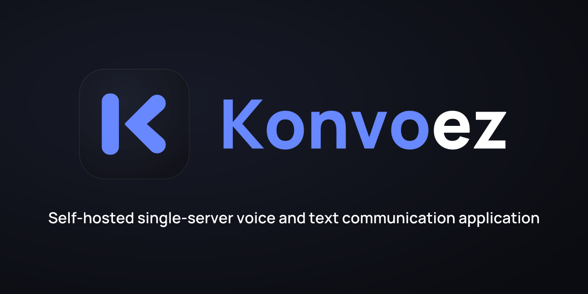
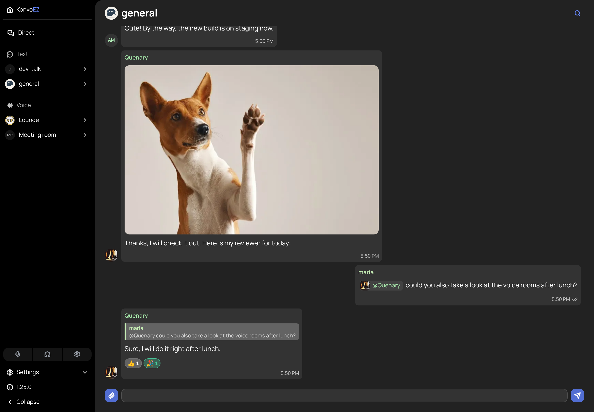
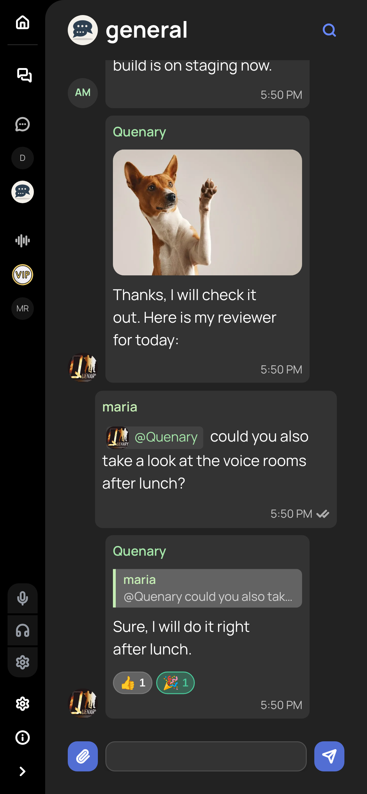

# Konvoez



Konvoez is a self-hosted, single-server voice and text communication application. It is a lightweight Discord-like alternative where the deployed instance acts as the server itself: one Docker container, minimal resource usage and a quick setup.

## Desktop App

[](https://github.com/Quenary/konvoez/releases/download/desktop-latest/Konvoez-Setup-x64.exe)
[](https://github.com/Quenary/konvoez/releases/download/desktop-latest/Konvoez-x86_64.AppImage)

All versions: [desktop releases](https://github.com/Quenary/konvoez/releases?q=desktop&expanded=true). Builds are unsigned: on Windows use **More info → Run anyway**, on Linux run `chmod +x` on the AppImage. See the [Desktop guide](apps/desktop/README.md).

## Table of Contents

- [Desktop App](#desktop-app)
- [Key Features](#key-features)
- [Deployment](#deployment)
- [Documentation](#documentation)
- [Screenshots](#screenshots)

## Key Features

- **Single-Server Model**: An application instance is a complete standalone server with its own text and voice rooms.
- **Voice Rooms**: Low-latency voice over WebRTC and the Mediasoup SFU, with noise suppression.
- **Camera & Screen Sharing**: Camera and screen streams in voice rooms and calls.
- **Direct Messages & Calls**: Private one-to-one chats and calls.
- **Text Chat**: Rich-text messages with replies, reactions, `@mentions` and file attachments.
- **Encrypted Messages**: Message text is encrypted at rest on the server with AES-256-GCM.
- **Two-Factor Authentication**: TOTP (RFC 6238) with authenticator apps and single-use recovery codes.
- **Notifications**: Web Push and native desktop notifications.
- **PWA & Desktop Client**: An installable web app and a desktop app for Windows and Linux.
- **Roles & Administration**: A single `OWNER`, configurable roles with granular permissions (seeded `Admin`, `Moderator`, `User`), private rooms, user management and invite-only registration.
- **Localization**: English and Russian.
- **Modern Monorepo**: Angular 22 (Signals) with Taiga UI on the frontend, NestJS on the backend, Electron for desktop, and shared TypeScript/Zod contracts, all in one Nx workspace.

## Deployment

Konvoez ships as a single Docker image: Nginx serves the frontend and proxies the API to NestJS, and Mediasoup handles voice and video. Data (SQLite, uploaded files, push keys) lives in the `konvoez_data` volume.

1. Create the config from the template and fill in the required variables:

   ```bash
   cp .env.example .env
   ```

   | Variable                 | Purpose                                                                                        |
   | ------------------------ | ---------------------------------------------------------------------------------------------- |
   | `MASTER_KEY`             | Secret for message encryption and VAPID key storage. Keep it: losing it makes data unreadable. |
   | `JWT_SECRET`             | Secret for session tokens.                                                                     |
   | `MEDIASOUP_ANNOUNCED_IP` | Public IPv4 or hostname that browsers use to reach the media server.                           |
   | `COOKIE_SECURE`          | Set to `true` when the instance is served over HTTPS.                                          |

   Generate secrets with `openssl rand -base64 32`. All other options are described in [.env.example](.env.example).

2. Start the server with one of the options below.

   **Prebuilt image (recommended)**, via [docker-compose.yml](docker-compose.yml):

   ```bash
   docker compose up -d
   ```

   **Build from source**, via [docker-compose.build.yml](docker-compose.build.yml):

   ```bash
   docker compose -f docker-compose.build.yml up -d --build
   ```

3. Open the server on port `80` (behind a reverse proxy in practice) and register the `OWNER` account.

To update the prebuilt image, run `docker compose pull && docker compose up -d`.

> [!IMPORTANT]
> **Initial OWNER setup**: on a fresh install the server prints a one-time token (valid for 5 minutes) to the container logs (`docker compose logs`). The token is required to register the `OWNER` account. If it expires, restart the container to get a new one.

> [!IMPORTANT]
> **Voice calls & HTTPS**:
>
> - **Ports & IP**: forward UDP/TCP `40000-40100` to the Docker host and set `MEDIASOUP_ANNOUNCED_IP` to your public IP or hostname.
> - **HTTPS**: browsers expose microphone and camera only in a secure context (HTTPS or `localhost`).
> - See the [Networking & Deployment Guide](docs/NETWORKING.md) for router, reverse proxy (Nginx/Caddy) and LAN setups.

## Documentation

**Using and operating**

- [Networking & Deployment Guide](docs/NETWORKING.md)
- [Security Policy](docs/SECURITY.md)
- [Desktop client](apps/desktop/README.md)
- [Changelog](CHANGELOG.md)

**Features**

- [User Management](docs/USER_MANAGEMENT.md)
- [Two-Factor Authentication](docs/TWO_FACTOR.md)
- [Password Recovery](docs/PASSWORD_RECOVERY.md)
- [Rooms](docs/ROOMS.md)
- [Chat reading](docs/CHAT_READING.md)
- [Mentions](docs/MENTIONS.md)
- [Notifications](docs/NOTIFICATIONS.md)
- [Message attachments](docs/ATTACHMENTS.md)
- [Message reactions](docs/MESSAGE_REACTIONS.md)

**Development**

- [Contributing Guidelines](docs/CONTRIBUTING.md)
- [Frontend voice](docs/frontend/VOICE.md)
- [Frontend streaming](docs/frontend/STREAMING.md)
- [Frontend noise suppression](docs/frontend/NOISE_SUPPRESSION.md)
- [Frontend chat list](docs/frontend/CHAT_LIST.md)
- Libraries: [shared](libs/shared/README.md), [client-shell](libs/client-shell/README.md), [ui-kit](libs/ui-kit/README.md), [client-dialogs](libs/client-dialogs/README.md)

## Screenshots

<p align="center">
  
  &nbsp;
  
</p>
