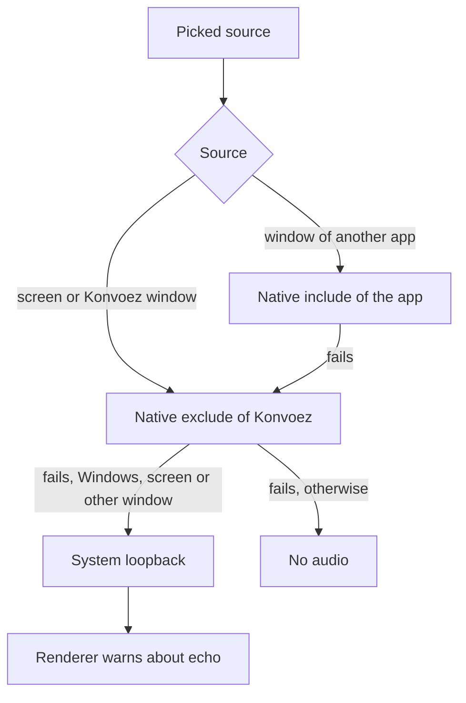

# Konvoez Desktop

Lightweight Electron wrapper around the Konvoez PWA: system tray, background voice, global mute/deafen hotkeys, native notifications, screen-share picker, and auto-updates.

## Downloads

- **Latest**: [desktop-latest](https://github.com/Quenary/konvoez/releases/tag/desktop-latest)
- **All releases**: [desktop-v*](https://github.com/Quenary/konvoez/releases?q=desktop-v&expanded=true)

| Platform | Artifact                  | Notes                                                                                                                                     |
| -------- | ------------------------- | ----------------------------------------------------------------------------------------------------------------------------------------- |
| Windows  | `Konvoez-Setup-x64.exe`   | Per-user install under `%LOCALAPPDATA%\Programs\konvoez` (no UAC). Installers are unsigned — SmartScreen: **More info** → **Run anyway**. |
| Linux    | `Konvoez-x86_64.AppImage` | `chmod +x` then run.                                                                                                                      |

## Development

```bash
npx nx run desktop:serve
npx nx run desktop:package
```

`nx build desktop` does not require Rust. `desktop:package` includes `konvoez-native.*.node` when `npx nx run desktop-native:build` has already produced it.

`desktop:serve` runs unpackaged Electron. On Windows its AppUserModelID is `com.quenary.konvoez.dev`; the packaged app keeps `com.quenary.konvoez`. A dev run therefore does not replace the installed taskbar icon with the Electron icon.

Release tags `desktop-v*` publish installers via GitHub Actions. `electron-updater` checks on startup and in the background. After the user starts the download, the app restarts and installs the update when the download finishes. During a voice call the restart waits until the user leaves; the update dialog stays above the main window and does not block the call.

## Usage

- **Server URL**: Required on first launch; validated via `/api/v1/public/version`. Production URLs must use `https://` (`http://` only for `localhost` / `127.0.0.1`). Change via tray **Change server…** or Settings.
- **Tray**: Closing the window hides to tray (`--hidden`); voice stays active. Tray shows mute/deafen state; menu: open, mute mic, deafen, settings, change server, check updates, quit (leaves voice first). Power suspend is blocked while in a voice channel or direct call.
- **Hotkeys**: Global toggle mic / deafen in Settings. Uses a non-blocking low-level hook on Windows (`WH_KEYBOARD_LL`) and Linux X11 (`XRecord`), ensuring keys are never blocked or swallowed. Held keys are forgotten when the hook restarts, the session locks, or a key-down arrives long after the last event for that key. On Wayland, when the native module is missing, or when the hook cannot be installed, falls back to `globalShortcut`, which captures a bound key in all apps. The settings hint follows the active mode.
- **Notifications**: DM/call alerts over the app WebSocket as native OS notifications; Web Push is disabled in the desktop shell to avoid duplicates. Click focuses the window and navigates to the corresponding chat.
- **Screen share**: Native picker for displays and windows (thumbnails/icons). Audio follows [Screen share audio](#screen-share-audio).

## Screen share audio

The main process tries the capture modes below in order and tells the renderer which one started: `include`, `exclude`, `loopback` or `none`. Native PCM reaches the page on a `MessagePort`. Konvoez's own audio is never captured.



- **Windows**: include targets the process tree of the window's app. A packaged app window belongs to `ApplicationFrameHost.exe`, so the hosted app process is used instead; if it is not running, include fails.
- **Linux**: include needs a stream chosen in the picker (windows tab); without one the capture is exclude. There is no loopback fallback, so a failure leaves the share video-only.
- **Konvoez window**: always exclude, so other apps' audio is shared but Konvoez's is not; a failure leaves it silent.

## Local dialogs (Lit)

Server, Settings, the source picker, and the update dialog are separate local windows. Their screens are Lit components built from `@konvoez/ui-kit`. Each screen receives the host only through `IKonvoezLocalBridge` in `@konvoez/client-shell`. The renderer exposes `window.konvoezLocal` from preload. Dialog bundles use a strict CSP and esbuild checks that Node globals do not leak.

Each window loads its own `host.css`, produced at build time by compiling Taiga UI LESS (`libs/ui-kit/src/theme/theme.less`) with system UI fonts. Dark mode follows the OS; components inherit `--tui-*` variables from the document (no per-component token sheets).

See also: [client-shell](../../libs/client-shell/README.md), [ui-kit](../../libs/ui-kit/README.md).

## Native module (Rust)

`libs/desktop-native` is a Rust NAPI addon providing process-isolated loopback audio capture and passive global keyboard hooks. Build prerequisites and workspace setup are in [CONTRIBUTING.md](../../docs/CONTRIBUTING.md#1-prerequisites).

- **Build**: `npx nx run desktop-native:build`
- **Tests**: `npx nx run desktop-native:test`
- **Lint**: `npx nx run desktop-native:lint`

If the native binary is missing or unsupported on the current host, the desktop app gracefully falls back to `globalShortcut` and standard audio capture. Linux reports audio support only after a PipeWire connection succeeds. Process loopback audio is available from Windows build 20348.

On Linux the addon links the host `libpipewire-0.3` dynamically. The AppImage does not bundle it, because the client library has to match the host PipeWire daemon, its plugins and its configuration. When the library is missing, the addon does not load at all, so the key hook falls back to `globalShortcut` as well.

## Security

Renderer: `contextIsolation`, `sandbox`, `nodeIntegration: false`. Preload exposes a typed IPC bridge (`window.konvoezDesktop`). Navigation stays on the configured server origin; external links open in the default browser. Mic, camera, and notification permissions are granted only for that origin.

Chromium is launched with `WebRtcAllowInputVolumeAdjustment` disabled so WebRTC AGC cannot change the OS microphone volume (Windows/macOS). In-app mic level remains a frontend `GainNode` only.

## Video encode

On Windows, Chromium is launched with `MediaFoundationAV1Encoding` enabled so WebRTC can use a hardware AV1 encoder when the GPU has one. Codec selection is described in [Frontend streaming](../../docs/frontend/STREAMING.md).
