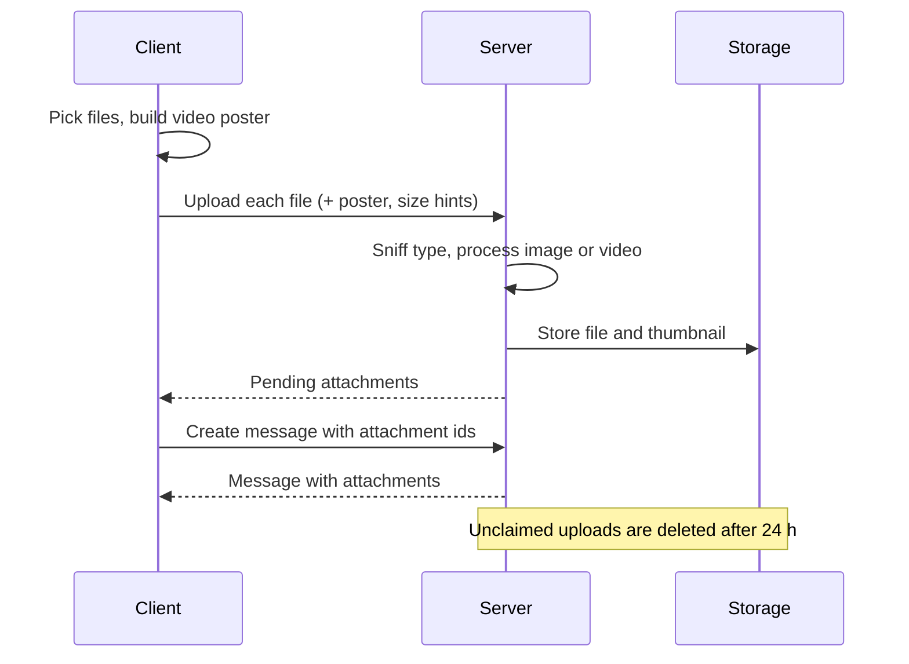
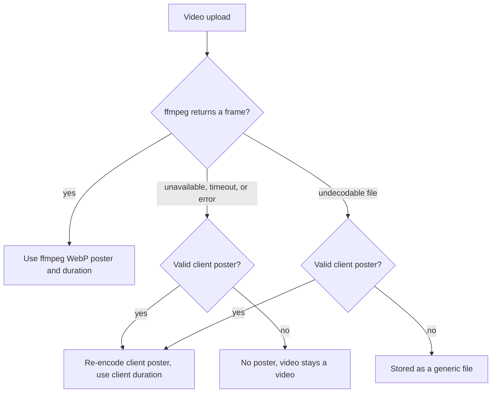

# Message attachments

The app supports files in messages. File bytes and the original file name are stored as uploaded.

## Flow

Files are uploaded when the message is sent, not when they are picked. Each upload creates a pending attachment that is claimed by the message.



- A user can have at most 30 pending uploads.
- Retrying a message with the same `clientId` returns the original message and does not send another push notification.
- Reloading the page drops unsent messages; uploaded files that were never attached expire after 24 hours.

## Limits

Admin settings (environment variables override the database). Every setting applies only to new uploads.

| Setting                             | Default | Range         |
| ----------------------------------- | ------- | ------------- |
| `ATTACHMENTS_ENABLED`               | on      | -             |
| `ATTACHMENTS_MAX_FILE_SIZE`         | 50 MiB  | 1 MiB - 1 GiB |
| `ATTACHMENTS_MAX_FILES_PER_MESSAGE` | 10      | up to 10      |
| `ATTACHMENTS_STRIP_IMAGE_METADATA`  | off     | -             |

With stripping off, a downloaded JPEG is byte-for-byte the upload, including EXIF and GPS. With stripping on, new JPEG, WebP, AVIF and PNG uploads are rotated and saved without metadata. GIFs and animations are left untouched. If stripping fails, the original is stored and a warning is logged. Thumbnails never contain metadata. If an image thumbnail cannot be built, the upload is stored as a generic file.

## Inline and download-only types

The server sniffs the real type. These types are shown inside the message:

- **Images**: JPEG, PNG, GIF, WebP, AVIF.
- **Video**: MP4, WebM, QuickTime (`.mov`).
- **Audio**: MP3, Ogg, WAV, MP4/M4A, AAC, FLAC.

Everything else (SVG, HTML, PDF, HEIC/HEIF and so on) is download-only. The server does not convert HEIC or transcode video. HEVC `.mov` plays only in browsers that can decode it; the rest get a download.

## Video posters

The browser builds a poster when a video is picked and uploads it with the file. The server picks the poster and duration like this:



- The client poster is untrusted: limited by size, type and pixel count, re-encoded to WebP with metadata removed. A bad poster is dropped and never fails the upload.
- The duration is shown as a badge on the tile; without a duration there is no badge.
- `ffmpeg` is **not** included in the runtime image. The server uses `FFMPEG_PATH` if set, otherwise `ffmpeg` from `PATH`. Mount a static build that matches the container architecture and Debian 12 glibc. The operator owns the binary, its updates and its license.

```yaml
services:
  app:
    volumes:
      - /opt/ffmpeg/ffmpeg:/usr/local/bin/ffmpeg:ro
    environment:
      FFMPEG_PATH: /usr/local/bin/ffmpeg
```

## Storage

Files are stored under logical keys `message-attachments/<uuid>` and `message-attachments/<uuid>-thumb`; the original name is never part of a key. The backend is local disk or S3 (`OBJECT_STORAGE`).

`OBJECT_STORAGE_PREFIX` (optional) adds a physical prefix to bucket or directory names. Setting or changing it points the app at new, empty containers: existing attachments and avatars are not moved.

## Access

Reading an attachment follows the rules for reading its message:

- Room messages: any logged-in user.
- Direct messages: only the sender and the recipient.
- Pending uploads: only the uploader.

Every denial returns `404`. Deleting a message follows the usual deletion rules, and a cleanup job removes the files afterward.

## Reverse proxy

The bundled Nginx accepts up to 1100 MiB for uploads, without request buffering; the application enforces the admin limit. The 50 MiB default fits Cloudflare Free/Pro (100 MB cap). If an admin raises the limit, every proxy in front must allow it; behind Cloudflare Free/Pro stay below 95 MiB.

## Client notes

- For a video, the poster is created immediately and shown in the composer. The upload waits for that attempt to finish.
- In an iOS home-screen app (standalone PWA) a download would open a preview with no way back. The client shows a dialog instead, loads the file with progress, and hands it to the share sheet. Very large files may fail there because they are held in memory. Browsers, Android and the desktop app use normal downloads.
