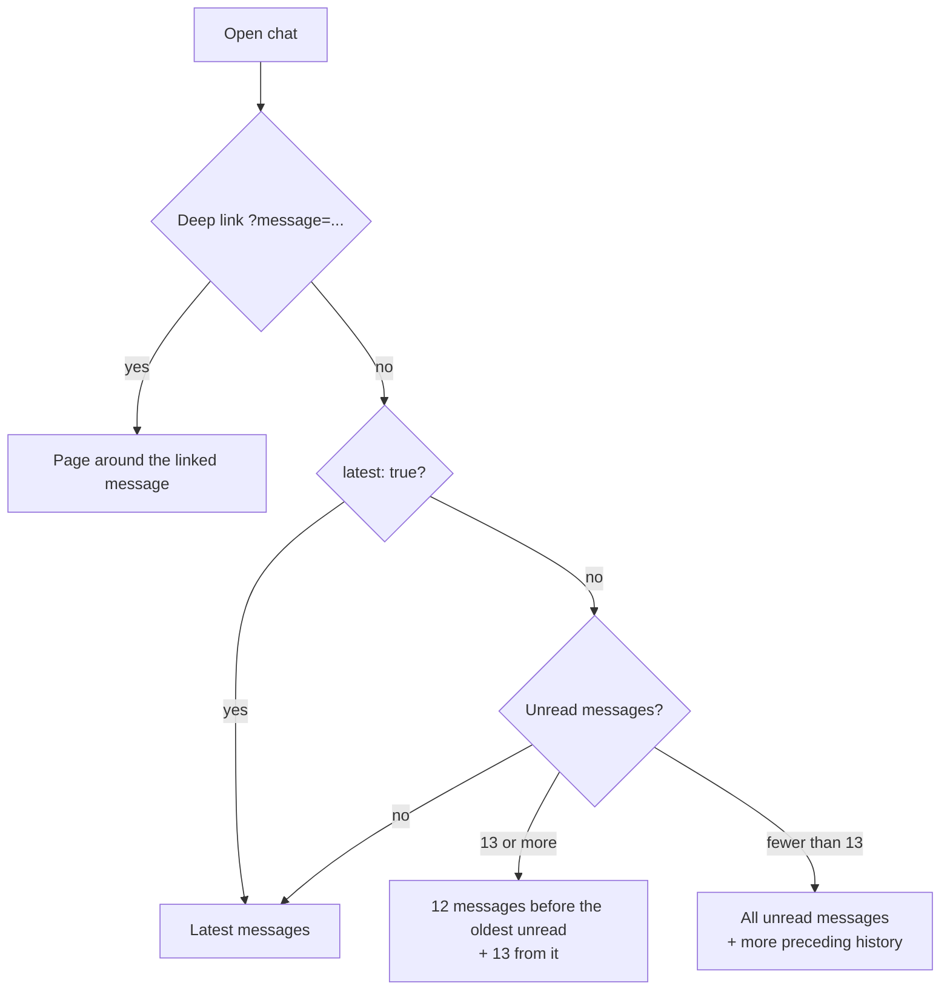

# Chat reading

Text rooms and direct messages open at the most useful place in the conversation, and unread counts reflect only messages that were actually seen.

## Opening a chat

The first page has up to 25 messages. Where it starts depends on how the chat is opened:

The response tells the client the first unread message and whether more pages exist before and after, so the list can load in both directions.

The **unread divider** is placed before the first unread message of the initial (or deep-link) page. It stays put while pages load, messages are read and new ones arrive. It is cleared by read-all or by leaving and re-entering the chat.

## Reading and unread counts

- Opening a chat does not clear its unread count. A message is marked read when it becomes visible in the list; requests are idempotent and are not repeated within the same session.
- The **scroll-to-bottom** button appears when the list is far from the bottom (more than 200 px) or newer pages exist. It shows the unread count; clicking it marks the chat as read and loads the latest page. Scrolling to the bottom alone does not mark everything as read.
- **Read-all** marks other users' messages up to the newest message at that moment as read; messages that arrive later stay unread. It targets exactly one chat, either a room or a direct recipient.

## Realtime and paging

- `UNREAD_COUNTS_CHANGED` replaces the unread counts across all of the user's sessions.
- `MESSAGES_READ` updates read receipts in the chat and in the reader's other sessions.
- While newer pages are still unloaded, live messages are not inserted into the list; they only increase the unread count. Newer pages load until the live tail is reached. Sending a message while behind loads the latest page first, so the message appears at the tail.
- When older history loads, the first visible message keeps its position on screen.
