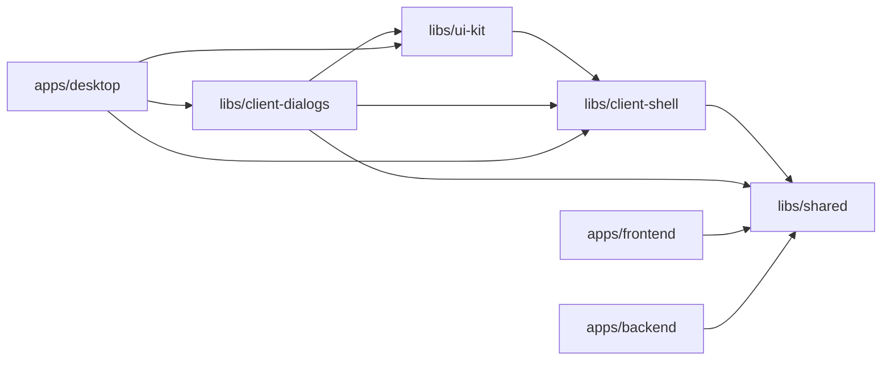

# Contributing

Contributions are welcome. The guidelines below keep the project consistent and maintainable.

## Architecture

Konvoez is an Nx monorepo. The server (backend, frontend) and the desktop client share contracts through `libs/shared`.

| Project               | Description                                                                                         |
| --------------------- | --------------------------------------------------------------------------------------------------- |
| `apps/frontend`       | Angular (Signals, standalone components, SCSS, Taiga UI).                                           |
| `apps/backend`        | NestJS, MikroORM, Mediasoup (WebRTC SFU), Socket.IO, AES-256-GCM message encryption.                |
| `apps/desktop`        | Electron client wrapping the frontend, built with esbuild and packaged with electron-builder.       |
| `libs/shared`         | TypeScript interfaces, enums, DTOs and Zod schemas shared by all projects.                          |
| `libs/client-shell`   | Framework-free client utilities: validation, adapter contracts, i18n core.                          |
| `libs/ui-kit`         | Lit web component primitives styled with Taiga UI design tokens.                                    |
| `libs/client-dialogs` | Lit dialogs for the desktop app (`k-server-dialog`, `k-settings-dialog`, `k-source-picker-dialog`). |

### Client Libraries Rules

Nx lint enforces the dependency direction. Client libraries never import `electron`, Node built-ins, `@angular/*` or `@taiga-ui/*`. Dialogs talk to the host only through adapter contracts from `@konvoez/client-shell`.



`apps/frontend` must not import `@konvoez/ui-kit` or `@konvoez/client-dialogs`.

## Getting started

1. **Prerequisites**: Node.js `^22.22.3` and npm `>=10.9`. Server video posters use an optional `ffmpeg` binary (`FFMPEG_PATH` or `ffmpeg` on `PATH`); without it posters are skipped and the browser poster is used. On Windows, native dependencies need VS Build Tools:

   ```bash
   winget install Microsoft.VisualStudio.2022.BuildTools --override "--quiet --add Microsoft.VisualStudio.Workload.VCTools --includeRecommended"
   ```

2. **Install dependencies**:

   ```bash
   npm ci

   # Windows desktop build without VS Build Tools
   npm ci --ignore-scripts
   node node_modules/electron/install.js
   ```

3. **Configure the environment**: copy `.env.example` to `.env`. `MASTER_KEY`, `JWT_SECRET` and `MEDIASOUP_ANNOUNCED_IP` must be set.

4. **Run**:

   ```bash
   npm run start:dev          # backend + frontend
   npx nx serve backend       # or each project separately
   npx nx serve frontend
   npm run start:dev:sw       # frontend with a service worker, for browser push
   ```

   Browser push requires a secure context, so use `localhost` or HTTPS.

5. **Build**: `npm run build`.

## Desktop

The Electron client has its own [guide](../apps/desktop/README.md). Run it with `npx nx run desktop:serve` and package it with `npx nx run desktop:package`. Installers are built by GitHub Actions on `desktop-v*` tags.

## Commits and releases

Commits follow [Conventional Commits](https://www.conventionalcommits.org/), for example `feat(backend): add message encryption`. Common types: `feat`, `fix`, `docs`, `refactor`, `test`, `chore`. Keep commits focused; Husky and lint-staged format and lint staged files before each commit.

Nx publishes two independent release groups. The paths touched by a commit decide which group is bumped:

| Group     | Projects                                              | Tag                  | Changelog                   |
| --------- | ----------------------------------------------------- | -------------------- | --------------------------- |
| `server`  | `backend`, `frontend`, `shared`                       | `v{version}`         | `CHANGELOG.md`              |
| `desktop` | `desktop`, `client-shell`, `ui-kit`, `client-dialogs` | `desktop-v{version}` | `apps/desktop/CHANGELOG.md` |

- Changes only in the desktop group bump `desktop`; changes only in `backend` or `frontend` bump `server`.
- Changes in `libs/shared` bump both groups, because desktop and `client-shell` import it.
- Keep dependency updates (`fix(deps)`) isolated to one area.

## Code Changes

- Follow the existing style and patterns; prefer clear, idiomatic solutions.
- Apply SOLID, KISS, DRY and YAGNI only when they simplify the change.
- Keep strict typing: use shared types and Zod schemas from `@konvoez/shared`.
- Avoid heavy or unnecessary dependencies.
- Format with Prettier (`npm run fmt`) and pass ESLint (`npm run lint`).

## Tests

- Every feature and bug fix comes with automated tests that lock the important behavior, not only call the code.
- Parameterize cases that differ only by inputs and expected results.
- Update existing tests when changing existing behavior.
- Before submitting, run `npm run test`, `npm run lint` and `npm run fmt` (or `npx nx run <project>:format:check` to only check).
- To check a single project, use `npx nx run <project>:test`, `npx nx run <project>:eslint:lint` and `npx nx run <project>:format:check`. Projects: `backend`, `frontend`, `shared`, `client-shell`, `ui-kit`, `client-dialogs`, `desktop`.

## Pull requests

- Describe what changed and why; reference related issues (`Closes #123`).
- Keep each pull request focused on a single responsibility.
- Discuss significant features or breaking architectural changes in an issue first.
- Update the documentation, including `README.md`, when behavior or configuration changes.
