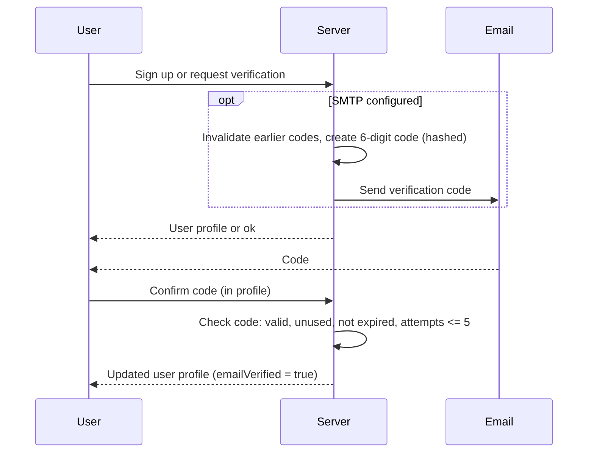
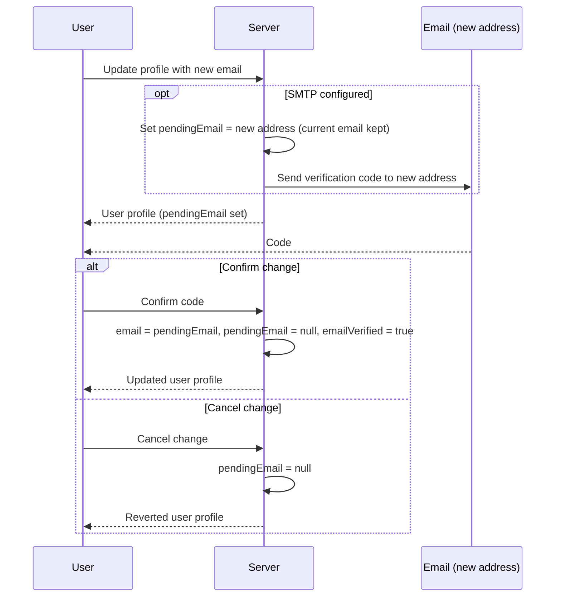

# Email verification and security notifications

The app supports verifying user email addresses with one-time codes and dispatching security notifications for critical account events. Email verification is active only when SMTP is configured through environment variables (`SMTP_*` in `.env.example`). Without `SMTP_HOST`, email verification is inactive, registration and profile updates do not issue codes, and security notifications are skipped.

## Flows

### Registration and manual verification

### Email change

## Rules

- **Activation**: active only when `SMTP_HOST` is configured. When SMTP is absent, registration succeeds immediately without issuing verification codes, and security notifications are omitted.
- **Access**: an unverified address does not block sign-in, HTTP, or realtime connections. `emailVerified` only decides whether security notifications may be sent to that address.
- **Sign-up**: newly registered users receive a 6-digit code when SMTP is configured. Existing accounts stay unverified until confirmed in the profile and keep full access in the meantime.
- **Verification flow**: verification codes are requested and confirmed by authenticated users through profile settings (`Settings -> Profile`). The confirming session receives the updated profile. Other signed-in sessions of the same account pick up the new verification status.
- **Email change**: updating an email sets `pendingEmail` and dispatches a verification code to the target address. The user's active email remains untouched until the code is confirmed. The change can be cancelled at any time.
- **Hashed codes**: only the Argon2id hash is stored in the database; plaintext codes exist only in the email message.
- **Security limits**:
  - Codes are 6 digits with a 15-minute TTL.
  - Maximum 5 failed attempts before a code record is permanently invalidated.
  - Rate limiting enforces a 60-second cooldown between requests per account.
  - A new code request marks earlier unused codes as used.
- **Password recovery interaction**: password recovery codes can be dispatched to an unverified email. Successfully completing a password recovery automatically marks the address as verified and sends a security notification.
- **Security notifications**: sent exclusively to verified email addresses when SMTP is configured. Events that trigger security notifications include:
  - Password recovery completed.
  - Password changed in profile settings.
  - Email address change confirmed (security alert sent to old email; confirmation sent to new email).
  - Two-factor authentication enabled.
  - Two-factor authentication disabled.
  - Two-factor recovery codes regenerated.
  - Two-factor recovery code used for login.
  - Two-factor authentication locked due to repeated failed attempts.
  - Two-factor authentication reset by an administrator.
  - Account roles updated by an administrator.
  - Account deactivated (anonymized) or permanently deleted.
