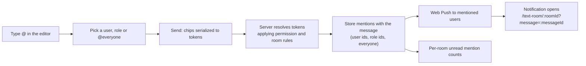

# Mentions

The app supports user, role and everyone `@mentions` in **text room** messages. Direct messages have no mentions.

## Mention types

Mentions are stored in message content as Discord-style canonical tokens.

| Type     | Token        | Notifies                          | Example     |
| -------- | ------------ | --------------------------------- | ----------- |
| User     | `<@userId>`  | A specific user                   | `<@42>`     |
| Role     | `<@&roleId>` | All users who have the role       | `<@&3>`     |
| Everyone | `@everyone`  | All users with access to the room | `@everyone` |

Tokens are parsed identically on client and server (`@konvoez/shared`). Mentions inside inline code or code blocks, and malformed tokens, stay plain text.

## Rules

- **`@everyone`** works only for users with `MENTION_EVERYONE` (or the `OWNER`). For anyone else it is plain text and notifies nobody.
- **Roles** are mentionable only when the role has `mentionable: true` (**Settings → Roles**). Other roles are not suggested and notify nobody.
- **Private rooms**: only users and roles that can access the room are suggested and notified.

## Flow

- Push notifications go to every eligible member mentioned directly, through a mentionable role or through `@everyone`, respecting each recipient's granular notification settings (see [Notifications](NOTIFICATIONS.md)).
- `GET /api/v1/text-rooms/unread-counts` returns unread mention counts per room in addition to message counts.

## UI

- **Editor**: typing `@` opens suggestions with matching users, mentionable roles and `@everyone` (if allowed), with keyboard navigation. Selected items become chips and are serialized to tokens on send; editing a message turns tokens back into chips.
- **Messages**: user chips show the avatar and name and open the profile dialog; role chips use the role color; `@everyone` has a group icon. Mentions of the current user, their role or everyone use the highlighted appearance.
- **Unread badge**: the rooms list shows an `@` badge while the room has unread mentions. Opening the room does not clear it; it decreases as the mentioned messages are read and is cleared by read-all (see [Chat reading](CHAT_READING.md)).
- **Deep link**: opening a mention notification navigates to the room and jumps to the message, loading history around it when needed.
