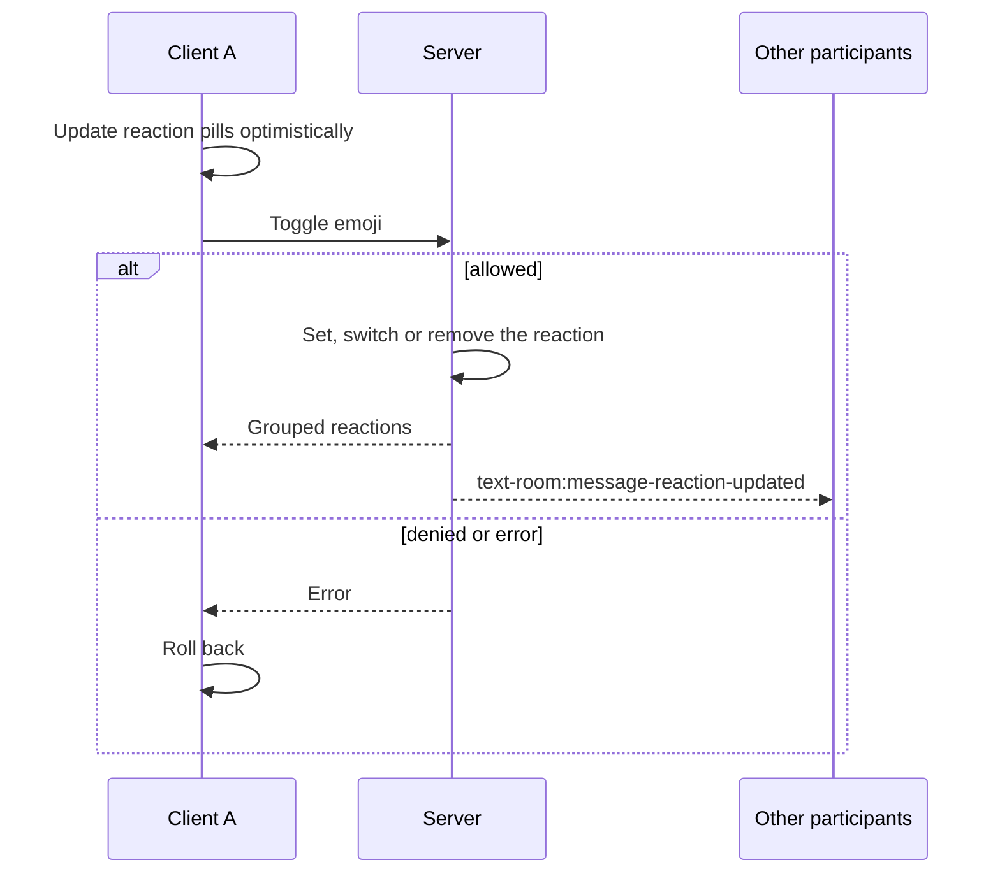

# Message reactions

The app supports emoji reactions on messages in text rooms and direct messages. Reactions follow a Telegram-style model: each user has at most one active reaction per message.

## Behavior

- Selecting an emoji sets the user's reaction.
- Selecting the same emoji again removes it.
- Selecting a different emoji replaces the previous reaction in place.
- Users can react to their own messages.
- Only room participants (or the sender and recipient of a direct message) can react. A deleted or missing message cannot be reacted to.
- The value must be a valid emoji (up to 32 characters, including modifiers, ZWJ sequences and flags); arbitrary text is rejected.

## Flow

A single endpoint toggles the reaction (`PUT /api/v1/text-rooms/messages/:id/reactions`) and returns the reactions grouped by emoji with their counts and user ids. The server then broadcasts the update to everyone in the chat.

## Client

- **Optimistic updates**: pills update on click and roll back if the request fails.
- **Ordered requests**: rapid clicks are queued in `ChatStore` (`concatMap`), so toggles run strictly in order.
- **Tooltips**: a pill lists the users who reacted (up to 10 names, then `+N`) and follows language changes.
- **Reactions bar**: hovering a message or opening its context menu shows quick reactions and an emoji picker.
