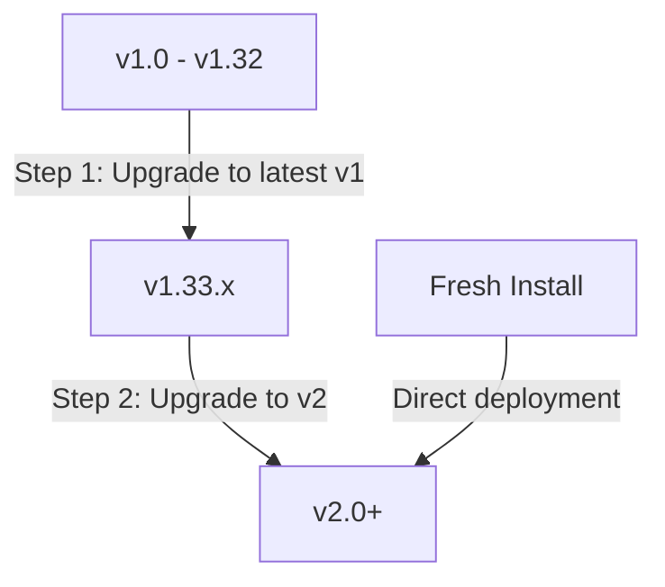

# Migration Guide: v1 to v2

Konvoez 2 consolidates all historical migrations into a declarative baseline using Knex SchemaBuilder, enabling cross-DBMS support (SQLite, PostgreSQL, MySQL) while preserving existing installations.

## Upgrade Prerequisites

Instances upgrading from version 1 must first be on the latest v1 release (v1.33.x).



The database must contain the latest release marker (`Migration20261116083850_RoomOrder`). On startup, the server validates migration history:

| State                | Condition                                            | Behavior                                                                                     |
| -------------------- | ---------------------------------------------------- | -------------------------------------------------------------------------------------------- |
| Fresh Database       | No migrations recorded                               | Runs the baseline migration directly on the configured database engine.                      |
| Upgrading from v1.33 | History contains `Migration20261116083850_RoomOrder` | Clears historical records and stamps the baseline migration without altering tables or data. |
| Outdated v1 Database | History lacks `Migration20261116083850_RoomOrder`    | Halts with an error requiring an intermediate upgrade to v1.33 before moving to v2.          |

> [!WARNING]
> Automatic baseline stamping applies within the same database engine (SQLite → SQLite). Switching `DB_ENGINE` to `postgres` or `mysql` connects to that engine as a fresh database and does not automatically dump or transfer existing data from SQLite.

## Updating Docker Deployment

1. In `docker-compose.yml`, update the image tag:

   ```yaml
   services:
     app:
       image: ghcr.io/quenary/konvoez:2
   ```

2. Pull the new image and restart the container:

   ```bash
   docker compose pull && docker compose up -d
   ```

3. Check logs to confirm successful baseline migration and startup:

   ```bash
   docker compose logs -f app
   ```

## Database Engines

Konvoez 2 supports SQLite, PostgreSQL, and MySQL. Configure the engine with `DB_ENGINE` (defaults to `sqlite`).

| Variable      | SQLite (default)               | PostgreSQL            | MySQL                 |
| ------------- | ------------------------------ | --------------------- | --------------------- |
| `DB_ENGINE`   | `sqlite`                       | `postgres`            | `mysql`               |
| `DB_NAME`     | `/konvoez_data/konvoez.sqlite` | Database name         | Database name         |
| `DB_HOST`     | _(unused)_                     | Hostname / IP         | Hostname / IP         |
| `DB_PORT`     | _(unused)_                     | Port (default `5432`) | Port (default `3306`) |
| `DB_USER`     | _(unused)_                     | Username              | Username              |
| `DB_PASSWORD` | _(unused)_                     | Password              | Password              |
