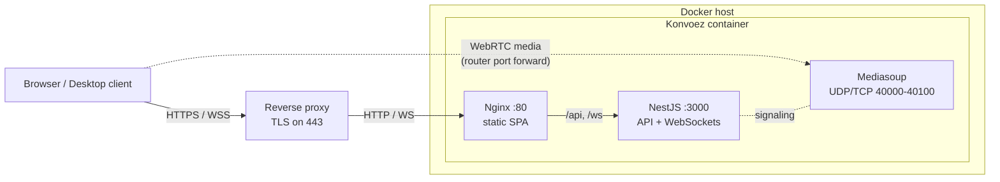

# Networking and deployment

How traffic reaches Konvoez, and how to configure routers, reverse proxies and Docker for self-hosted deployments.

## Architecture

Konvoez uses two independent channels:

1. **Signaling and API (TCP)**: HTTP REST (`/api/v1/...`) and Socket.IO WebSockets (`/ws/v1/text`, `/ws/v1/voice`). They go through the reverse proxy.
2. **Media (UDP, TCP fallback)**: WebRTC audio and video handled by the Mediasoup SFU. Media goes **directly** to the Docker host on ports `40000-40100`.



Media bypasses the reverse proxy because an HTTP proxy cannot relay dynamic UDP/RTP streams. After the signaling handshake (ICE candidates, DTLS keys) over `/ws/v1/voice`, the browser opens a UDP connection straight to the address announced by Mediasoup.

## Setup

If the host has a private IP (for example `192.168.0.10`) while the domain points to a public IP:

### 1. Forward the media ports

On the router forward `40000-40100` (UDP, plus TCP as a fallback) to the Docker host. The same range must be published by Docker (see [Docker network modes](#docker-network-modes)) and allowed by the host firewall (`ufw`, `firewalld`, Windows Firewall).

Capacity: each participant uses 2 transports (send and receive), and each transport takes one UDP and one TCP port per announced address. One address on `40000-40100` fits about 100 transports (50 participants). Every extra address that shares the range halves that; with per-address ranges the smallest range sets the limit. Widen the ranges, and the Docker and router mappings, when adding addresses.

<details>
<summary>Example: MikroTik RouterOS</summary>

`MY_DDNS_IP` is an address list that holds the public IP (for example kept up to date from a DNS name). The hairpin rules are needed only when LAN clients connect through the public address; announcing the LAN IP first avoids them.

```
/ip firewall nat add chain=dstnat action=dst-nat protocol=udp dst-address-list=MY_DDNS_IP dst-port=40000-40100 to-addresses=192.168.88.10 to-ports=40000-40100 comment="Konvoez WebRTC UDP"
/ip firewall nat add chain=dstnat action=dst-nat protocol=tcp dst-address-list=MY_DDNS_IP dst-port=40000-40100 to-addresses=192.168.88.10 to-ports=40000-40100 comment="Konvoez WebRTC TCP"

# Hairpin NAT, placed before the default masquerade
/ip firewall nat add chain=srcnat action=masquerade protocol=udp src-address=192.168.88.0/24 dst-address=192.168.88.10 dst-port=40000-40100 comment="Konvoez hairpin UDP" place-before=[find comment="defconf: masquerade"]
/ip firewall nat add chain=srcnat action=masquerade protocol=tcp src-address=192.168.88.0/24 dst-address=192.168.88.10 dst-port=40000-40100 comment="Konvoez hairpin TCP" place-before=[find comment="defconf: masquerade"]
```

</details>

### 2. Announce the public address

Mediasoup sends `MEDIASOUP_ANNOUNCED_IP` to browsers as an ICE candidate. If it is unset or holds a private LAN address, external users receive an unreachable candidate and have no audio.

```env
MEDIASOUP_ANNOUNCED_IP=203.0.113.5
```

The value is a comma-separated list of `address[:start-end]` entries:

- `address` is an IPv4 address or a hostname (IPv6 is not supported). Hostnames are resolved to IPv4 on every transport creation, which also picks up DDNS changes. The server uses its own DNS, so with split-horizon DNS list the public IP instead.
- `:start-end` assigns the address its own port range. Entries without a range use `MEDIASOUP_PORT_RANGE` (default `40000-40100`). Ranges may overlap; the Docker mapping must cover all of them.
- The backend refuses to start on a malformed entry or range and names the variable and value.

```env
MEDIASOUP_PORT_RANGE=40000-40100
MEDIASOUP_ANNOUNCED_IP=203.0.113.5:40000-40049, 192.168.0.10:40050-40100
```

#### LAN and internet clients

Without NAT loopback (hairpin NAT), LAN clients cannot reach the public IP. Announce the LAN IP together with the public address. Each address gets its own UDP and TCP candidate and browsers try all of them. The order sets which one is tried first: with the LAN IP first, local clients connect directly and external clients fall back to the public address.

```env
MEDIASOUP_ANNOUNCED_IP=192.168.0.10,konvoez.example.com
```

To reserve ports for LAN clients, give each address its own range and forward only the public range on the router:

```env
MEDIASOUP_ANNOUNCED_IP=192.168.0.10:40050-40100,konvoez.example.com:40000-40049
```

### 3. Reverse proxy

The proxy terminates HTTPS and forwards HTTP and WebSocket traffic to port `80` of the container. Example for Nginx:

```nginx
server {
    listen 443 ssl http2;
    server_name konvoez.example.com;

    ssl_certificate /path/to/fullchain.pem;
    ssl_certificate_key /path/to/privkey.pem;

    location / {
        # At least the admin attachment limit; matches the bundled nginx
        client_max_body_size 1100m;
        proxy_pass http://192.168.0.10:80;
        proxy_http_version 1.1;

        # WebSocket support (required for Socket.IO)
        proxy_set_header Upgrade $http_upgrade;
        proxy_set_header Connection "upgrade";

        proxy_set_header Host $host;
        proxy_set_header X-Real-IP $remote_addr;
        proxy_set_header X-Forwarded-For $proxy_add_x_forwarded_for;
        proxy_set_header X-Forwarded-Proto $scheme;
    }
}
```

Set `COOKIE_SECURE=true` when the instance is served over HTTPS. See [Attachments](ATTACHMENTS.md#reverse-proxy) for upload size limits.

## Docker network modes

| Mode                            | Configuration                                                        | Notes                                                                                                         |
| ------------------------------- | -------------------------------------------------------------------- | ------------------------------------------------------------------------------------------------------------- |
| **Bridge** (default)            | Publish `80` and `40000-40100` (UDP and TCP) in `docker-compose.yml` | Works on Linux, Windows (WSL2 / Docker Desktop) and macOS. A narrow range avoids the `docker-proxy` overhead. |
| **Host** (`network_mode: host`) | Remove the `ports` section                                           | Linux only. Removes Docker NAT overhead; best for dedicated servers with many participants.                   |

## Voice bandwidth

Outbound media bandwidth from the Mediasoup SFU scales with the number of concurrent speakers and listeners:

- Base microphone bitrate defaults to 64 kbit/s and is configured in server settings (`VOICE_MAX_BITRATE_KBPS`, range 8–384 kbit/s).
- At 64 kbit/s, one active speaker with 9 listeners requires approximately 0.6 Mbit/s outbound server bandwidth.
- Sender-side dynamic adaptation steps degraded clients down upon packet loss or high RTT, reducing client uplink and server fanout.

## Troubleshooting

| Symptom                                       | Cause                                                                      | Fix                                                                                                                                                        |
| --------------------------------------------- | -------------------------------------------------------------------------- | ---------------------------------------------------------------------------------------------------------------------------------------------------------- |
| Voice shows "Connected" but there is no audio | Signaling works, but UDP media is blocked or misrouted.                    | Check the router forward to the Docker host, that `MEDIASOUP_ANNOUNCED_IP` matches the current public IP, and that the host firewall allows `40000-40100`. |
| External users talk, LAN users cannot         | The router has no NAT loopback, so LAN clients cannot reach the public IP. | Enable NAT loopback / hairpin NAT, or announce the LAN IP as well ([LAN and internet clients](#lan-and-internet-clients)).                                 |
