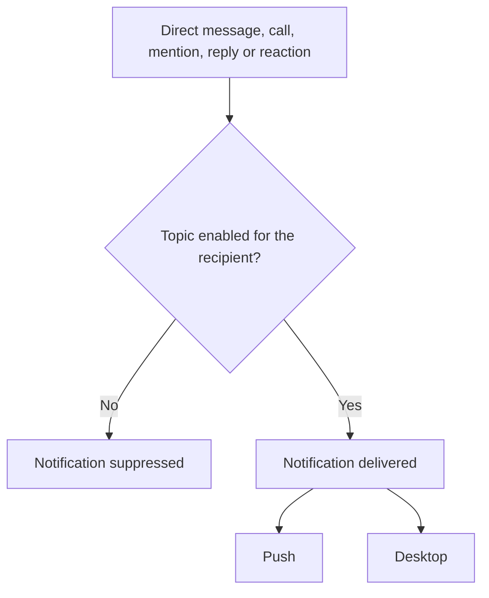
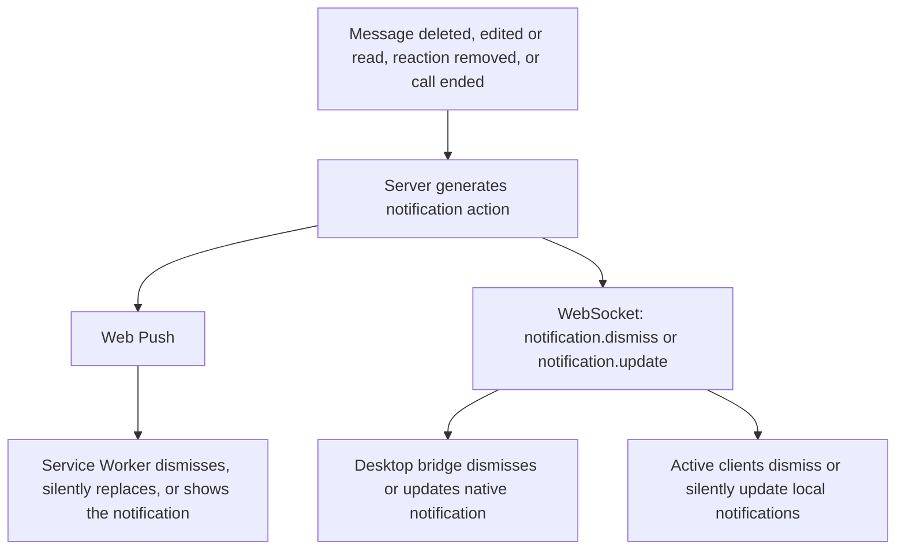

# Notifications

Konvoez delivers outbound notifications to users through two channels: browser push notifications and native desktop notifications. Each user controls which events produce a notification.

## Channels

| Channel | Used by                                     |
| ------- | ------------------------------------------- |
| Push    | Browsers that the user subscribed           |
| Desktop | The desktop app while the user is signed in |

## Topics

The server stores the settings per user and applies them to both channels. All topics are enabled by default.

| Topic            | Triggers a notification when                    |
| ---------------- | ----------------------------------------------- |
| Direct messages  | The user receives a direct message              |
| Direct calls     | The user receives an incoming direct voice call |
| Replies          | The message replies to the user's message       |
| Reactions        | A reaction is added to the user's message       |
| Username mention | The message mentions the user by name           |
| Role mention     | The message mentions a role the user has        |
| Everyone mention | The message mentions everyone in the room       |

## Delivery flow

The server checks the recipient's settings before every delivery. A suppressed event produces no push and no desktop notification.

### Several triggers in one message

When one message triggers several notification topics for a recipient (for example a mention and a reply, or multiple mentions), the recipient is notified once if at least one of the matching topics is enabled. The notification is suppressed only when all matching topics are disabled.

## Notification dismissal and replacement

Notifications are automatically dismissed or replaced when the underlying trigger is removed:

- **Message deleted**: Open notifications for the deleted message are dismissed across all recipients.
- **Message read**: Matching message, mention and reply notifications are dismissed on the reader's devices. Read batches are handled together; read-all covers messages up to its read boundary. Reaction notifications are unaffected.
- **Message edited**: Previous mention, reply and direct-message recipients receive the new text, including recipients who lost room access or who are no longer mentioned. Deleted accounts are skipped. The server does not check room access or topic settings again. A displayed notification is replaced silently. A queued notification is replaced with the new text and shown when it is delivered.
- **Reaction removed**: The reaction notification is dismissed for the message author.
- **Direct call ended**: Incoming call notifications are dismissed once answered, rejected, or timed out.

### Dismissal flow

- **Web Push**: Outbound notifications use deterministic RFC 8030 topics (`msg_*`, `rx_*`, `call_*`). Deleting a message or ending a call uses the matching topic and `TTL: 0` to replace a pending delivery with a dismiss action. Editing a message reuses its message topic and sends the updated notification with the normal TTL, so a queued delivery keeps the new text. The service worker replaces a displayed notification silently and shows the updated notification when none is displayed. Read batches carry message tags, while read-all carries a chat and message boundary, so each read action closes matching displayed notifications without sending one request per message.
- **Delivery limits**: RFC 8030 topics are exact replacement keys for pending messages on one subscription, not wildcard selectors or commands to close notifications already displayed by the operating system. Read cleanup is best effort when a user agent is reachable; a batched read action cannot cancel every pending message that has a different topic. A `TTL: 0` dismiss expires if the user agent is unavailable.
- **Desktop**: The desktop client tracks native notifications and closes or silently updates them after receiving the matching event over IPC.
- **Web App**: An open tab closes notifications by tag or read boundary. A socket update replaces only a displayed notification with the same tag and does not alert again.

## Scope of the settings

The settings affect only outbound push and desktop notifications. Message delivery inside the app, unread counts and mention badges do not depend on them.
