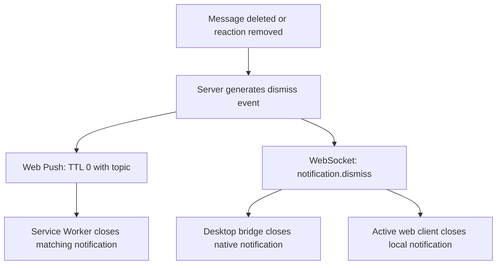

# Notifications

Konvoez delivers outbound notifications to users through two channels: browser push notifications and native desktop notifications. Each user controls which events produce a notification.

## Channels

| Channel | Used by                                     |
| ------- | ------------------------------------------- |
| Push    | Browsers that the user subscribed           |
| Desktop | The desktop app while the user is signed in |

## Topics

The server stores the settings per user and applies them to both channels. All topics are enabled by default.

| Topic            | Triggers a notification when                    |
| ---------------- | ----------------------------------------------- |
| Direct messages  | The user receives a direct message              |
| Direct calls     | The user receives an incoming direct voice call |
| Replies          | The message replies to the user's message       |
| Reactions        | A reaction is added to the user's message       |
| Username mention | The message mentions the user by name           |
| Role mention     | The message mentions a role the user has        |
| Everyone mention | The message mentions everyone in the room       |

## Delivery flow

The server checks the recipient's settings before every delivery. A suppressed event produces no push and no desktop notification.

### Several triggers in one message

When one message triggers several notification topics for a recipient (for example a mention and a reply, or multiple mentions), the recipient is notified once if at least one of the matching topics is enabled. The notification is suppressed only when all matching topics are disabled.

## Notification dismissal and replacement

Notifications are automatically dismissed or replaced when the underlying trigger is removed:

- **Message deleted**: Open notifications for the deleted message are dismissed across all recipients.
- **Reaction removed**: The reaction notification is dismissed for the message author.
- **Direct call ended**: Incoming call notifications are dismissed once answered, rejected, or timed out.

### Dismissal flow

- **Web Push**: Outbound push notifications use deterministic RFC 8030 topic identifiers (`msg_*`, `rx_*`, `call_*`). When dismissing, a push message with `TTL: 0` and the same topic instructs push services to discard pending deliveries, while service workers close any matching displayed notifications.
- **Desktop**: The desktop client tracks native notifications and closes them upon receiving a dismissal event over IPC.
- **Web App**: An open tab closes the displayed notification with the same tag. Deleting a message closes every displayed notification for that message.

## Scope of the settings

The settings affect only outbound push and desktop notifications. Message delivery inside the app, unread counts and mention badges do not depend on them.
