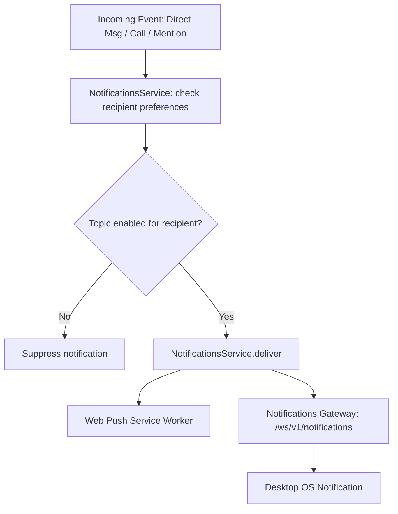

# Notifications

Konvoez delivers outbound notifications across two channels: browser Web Push and native desktop notifications.

## Channels

| Channel  | Transport                                   | Consumer                                       |
| -------- | ------------------------------------------- | ---------------------------------------------- |
| Web Push | Encrypted payload via VAPID (`web-push`)    | Browser Service Worker                         |
| Desktop  | Realtime WebSocket (`/ws/v1/notifications`) | Electron Main Process (`DesktopBridgeService`) |

## Granular topics

Users can configure their notification preferences per topic in **Settings → Notifications**. Settings are stored per user on the server (`user_notification_settings` table) and apply to both Web Push and desktop notifications.

| Topic               | Description                           | Default |
| ------------------- | ------------------------------------- | ------- |
| `directMessages`    | Direct messages in private chats      | `true`  |
| `directCalls`       | Incoming direct voice calls           | `true`  |
| `mentions.username` | Personal `@username` mentions         | `true`  |
| `mentions.role`     | Mentions of the user's assigned roles | `true`  |
| `mentions.everyone` | Room-wide `@everyone` mentions        | `true`  |

## Delivery flow

Notification filtering happens in a single location: `NotificationsService` on the backend. Incoming domain events are evaluated against the recipient's preferences before dispatching to delivery transports.

### Multi-mention resolution

When a message contains several mentions that apply to a recipient (for example, `@everyone` and `<@userId>`), the notification is delivered if **at least one** of the matching topics is enabled in the recipient's settings. A notification is suppressed only when all applicable topics are disabled.

Notification preferences only govern outbound push and desktop notifications; in-app room message delivery, unread counts, and room `@` badges remain unaffected.
