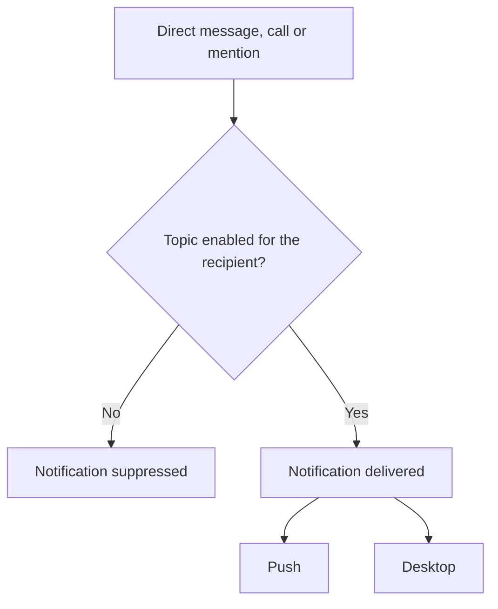

# Notifications

Konvoez delivers outbound notifications to users through two channels: browser push notifications and native desktop notifications. Each user controls which events produce a notification.

## Channels

| Channel | Used by                                     |
| ------- | ------------------------------------------- |
| Push    | Browsers that the user subscribed           |
| Desktop | The desktop app while the user is signed in |

## Topics

The server stores the settings per user and applies them to both channels. All topics are enabled by default.

| Topic            | Triggers a notification when                    |
| ---------------- | ----------------------------------------------- |
| Direct messages  | The user receives a direct message              |
| Direct calls     | The user receives an incoming direct voice call |
| Username mention | The message mentions the user by name           |
| Role mention     | The message mentions a role the user has        |
| Everyone mention | The message mentions everyone in the room       |

## Delivery flow

The server checks the recipient's settings before every delivery. A suppressed event produces no push and no desktop notification.

### Several mentions in one message

When one message mentions a recipient in several ways (for example by name and through everyone), the recipient is notified if at least one of the matching topics is enabled. The notification is suppressed only when all matching topics are disabled.

## Scope of the settings

The settings affect only outbound push and desktop notifications. Message delivery inside the app, unread counts and mention badges do not depend on them.
