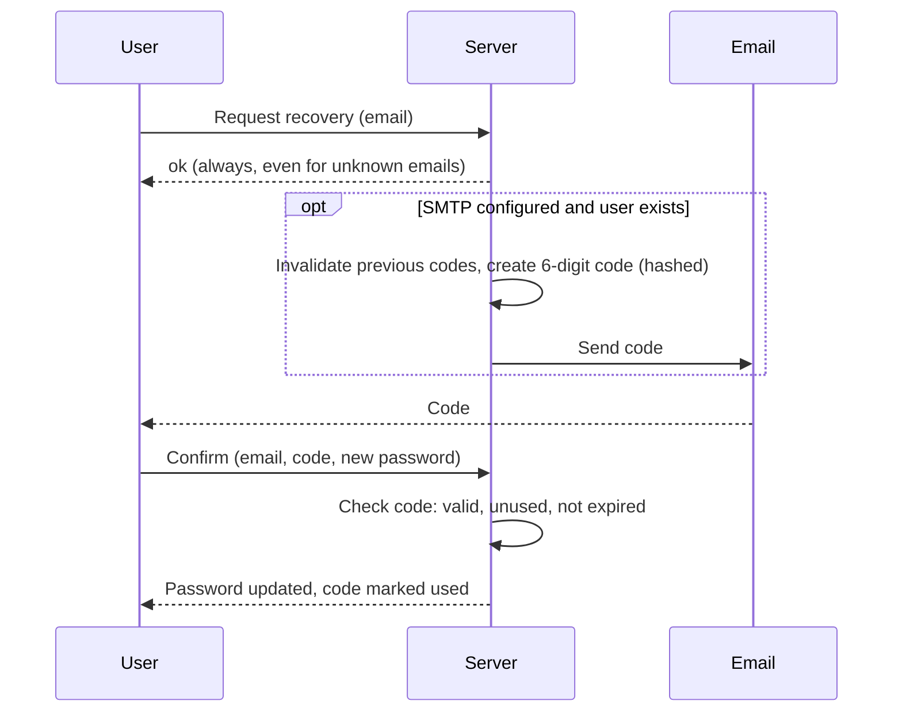

# Password recovery

The app supports resetting a forgotten password with a one-time code sent by email. SMTP is configured only through environment variables (`SMTP_*` in `.env.example`); without `SMTP_HOST`, recovery requests return `503`.

## Flow

## Rules

- **TTL**: `PASSWORD_RECOVERY_CODE_TTL`, default 10 minutes, range 1 minute to 1 hour. It can be changed in the admin settings (`MANAGE_SETTINGS` or `OWNER`) or through the environment.
- **No account enumeration**: the request always succeeds, whether or not the email is registered.
- **Hashed codes**: only the Argon2id hash is stored; the plaintext exists only in the email.
- **Single use**: a new request invalidates earlier unused codes, and a used code cannot be reused.
- **Rate limit**: about a 60-second cooldown per email for requests.
- **Session invalidation**: confirming a password reset signs out all active sessions.
- **Deleted accounts** cannot recover a password (see [User management](USER_MANAGEMENT.md)).
