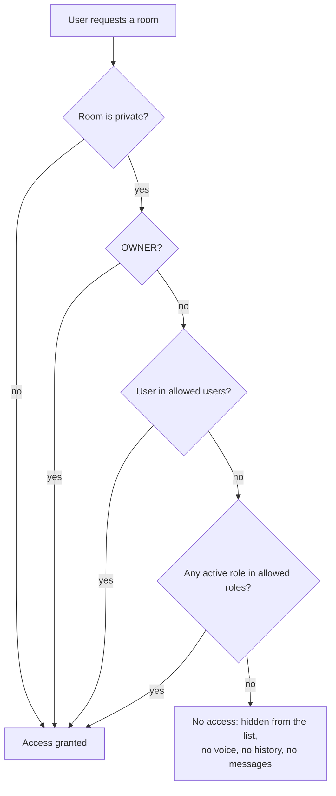

# Rooms

The app supports text and voice rooms. Any authenticated user can list and use the rooms they have access to. Creating, editing and deleting rooms (and uploading a room avatar) requires `MANAGE_ROOMS` or `OWNER`; other users get `403`.

The room author (id, username, full name) is recorded for audit and returned with the room, but it does not grant edit or delete rights. Room names are unique; a duplicate returns `409`.

## Access control

Rooms are **public** (visible to every authenticated user) or **private** (restricted to allowed roles and allowed users).



Active roles include assigned roles and the default roles.

## Moving members

Users with `MOVE_MEMBERS` or the `OWNER` can move a connected voice participant into another voice room.

```mermaid
sequenceDiagram
  participant Actor as Actor
  participant Srv as Server
  participant Target as Moved user

  Actor->>Srv: voice:move-member
  Note over Srv: Actor can access both rooms.<br/>Only OWNER can move OWNER.
  Srv-->>Actor: Ack
  Srv->>Target: voice:moved on the sockets in the source room
  Target->>Srv: voice:join-room
  Note over Srv: Grant is consumed after the peer is registered.<br/>An existing guest rejoins without a new grant.
```

- The actor must have access to the source and target voice rooms. The target user must already be in a voice room, and the target room must differ from the source. The move event goes only to that user's sockets in the source room.
- A successful move creates a short-lived in-memory grant. It lets the target join a room they cannot otherwise access, including a private room. The grant is spent only after the voice peer is registered, so a failed join can be retried until it expires.
- While the user is a guest of that room, the room is included in their room list and in sync updates. An explicit leave or a move to another room ends the guest access at once and the server sends `ROOM_DELETED` if they still have no access. After a connection loss the access is kept for a short reconnect window so the client can rejoin without a new grant. A later join needs a new grant or normal access.

## UI

- The **add** buttons (text, voice) and the per-room context menu (edit, delete) in the rooms list are shown only to users with `MANAGE_ROOMS` or the `OWNER`.
- The edit dialog sets privacy, allowed roles and allowed users, and shows the read-only author, created and updated fields.
- Deleting a voice room closes its active voice session for all participants (see [Voice](frontend/VOICE.md)).
- Users with `MOVE_MEMBERS` or the `OWNER` can move a sidebar member into another accessible voice room. The moved user is notified and joins that room. When a voice room view is already open, it follows a successful join.

## Related

- [Mentions](MENTIONS.md): `@user`, `@Role` and `@everyone` in text rooms, with the `@` badge for unread mentions.
- [Chat reading](CHAT_READING.md): opening a chat and unread counts.
