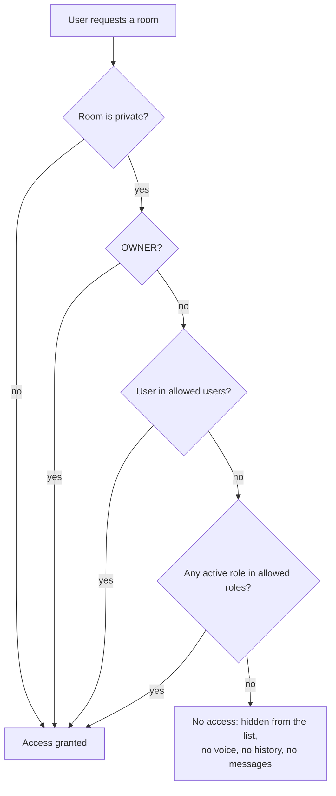

# Rooms

The app supports text and voice rooms. Any authenticated user can list and use the rooms they have access to. Creating, editing and deleting rooms (and uploading a room avatar) requires `MANAGE_ROOMS` or `OWNER`; other users get `403`.

The room author (id, username, full name) is recorded for audit and returned with the room, but it does not grant edit or delete rights. Room names are unique; a duplicate returns `409`.

## Access control

Rooms are **public** (visible to every authenticated user) or **private** (restricted to allowed roles and allowed users).



Active roles include assigned roles and the default roles.

## Moving and disconnecting members

Users with `MOVE_MEMBERS` or the `OWNER` can move a connected voice participant into another voice room or disconnect them from voice.

```mermaid
sequenceDiagram
  participant Actor as Actor
  participant Srv as Server
  participant Target as Target user

  rect rgb(240, 248, 255)
    Note over Actor,Target: Moving a member
    Actor->>Srv: voice:move-member
    Note over Srv: Actor can access both rooms.<br/>Only OWNER can move OWNER.
    Srv-->>Actor: Ack
    Srv->>Target: voice:moved on the sockets in the source room
    Target->>Srv: voice:join-room
  end

  rect rgb(255, 245, 245)
    Note over Actor,Target: Disconnecting a member
    Actor->>Srv: voice:disconnect-member
    Note over Srv: Actor can access room.<br/>Only OWNER can disconnect OWNER.
    Srv->>Target: voice:disconnected
    Note over Srv: Closes producers and transports.<br/>Revokes temporary grants.
    Srv-->>Actor: Ack
  end
```

- **Move rules**: The actor must have access to the source and target voice rooms. The target user must already be in a voice room, and the target room must differ from the source. The move event goes only to that user's sockets in the source room.
- A successful move creates a short-lived in-memory grant. It lets the target join a room they cannot otherwise access, including a private room. The grant is spent only after the voice peer is registered, so a failed join can be retried until it expires.
- While the user is a guest of that room, the room is included in their room list and in sync updates. An explicit leave or a move to another room ends the guest access at once and the server sends `ROOM_DELETED` if they still have no access. After a connection loss the access is kept for a short reconnect window so the client can rejoin without a new grant. A later join needs a new grant or normal access.
- **Disconnect rules**: The actor must have access to the target user's current voice room. Only the `OWNER` can disconnect the `OWNER`. Disconnecting closes the target's producers, consumers, and transports immediately, updates lobby presence, and revokes any temporary guest access and pending move grants so the target cannot rejoin without normal authorization. The target's client tears down local session state without auto-reconnecting. General application sockets remain unaffected.

## UI

- On a handset the sidebar is replaced by a bottom tab bar with Direct, text rooms, voice rooms, and settings. A child route opens the chat or room above the bar. The header back button follows in-app history and opens the parent list when that history is empty.
- On the next breakpoint the sidebar stays and collapses automatically. Navigation collapses it again.
- On a wide screen the sidebar stays. The text and voice section headers open the room lists.
- The **add** buttons (text, voice) in the rooms list and list screen headers are shown only to users with `MANAGE_ROOMS` or the `OWNER`.
- The per-room right-click context menu and the header ellipsis menu include a top «Подробнее» action for all users. The edit and delete options are shown only to users with `MANAGE_ROOMS` or the `OWNER`.
- Clicking a room header (avatar and title) opens the **details dialog** (`room-details-dialog`) without a window title. Clicking a direct chat header opens the **user dialog** (`user-dialog`).
- The details dialog displays the avatar, the room name, and the room type. Edit and delete, shown to users with `MANAGE_ROOMS` or the `OWNER`, are icon buttons aligned to the right. For text rooms it embeds a **files gallery** (`media-gallery`) with attachment counts by type (images, videos, audio, files). Selecting a type opens an in-dialog grid with newest-first infinite scroll. Clicking an item opens a full preview or downloads the file; "Go to message" opens that message in the chat and scrolls it into view. The gallery is hidden for voice rooms.
- The user dialog shows the nickname and, when it differs, the full name underneath. Opened from a direct chat header, it shows the files gallery and hides the message field. Opened from a voice-room peer in the sidebar, or from «Подробнее» in the user context menu on a voice tile (including the local participant), it shows the message field and hides the gallery. "Go to message" opens the message in the direct chat. An active direct call switches to the chat first.
- The edit dialog (`room-dialog`) sets privacy, allowed roles and allowed users, and shows the read-only author, created and updated fields.
- Deleting a voice room closes its active voice session for all participants (see [Voice](frontend/VOICE.md)).
- The voice room list shows up to two participant avatars and a `+N` count for the rest.
- The sidebar member context menu (right-click or long-tap, only when that member can be moved) and the ellipsis on a voice tile share the user context menu. The first action is «Подробнее», which opens the user dialog. In a group voice room, users with `MOVE_MEMBERS` or the `OWNER` also see other voice rooms and disconnect; only the `OWNER` can move or disconnect the `OWNER`. A direct call shows only «Подробнее».
- Users with `MOVE_MEMBERS` or the `OWNER` can move a member into another accessible voice room or disconnect them from voice. The moved user is notified and joins that room (an open voice room view follows the new room); a disconnected user is notified and navigated home if the voice room view was open.

## Related

- [Mentions](MENTIONS.md): `@user`, `@Role` and `@everyone` in text rooms, with the `@` badge for unread mentions.
- [Chat reading](CHAT_READING.md): opening a chat and unread counts.
