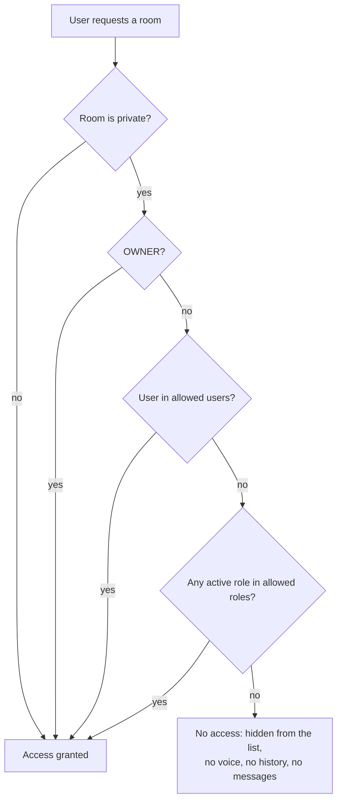

# Rooms

The app supports text and voice rooms. Any authenticated user can list and use the rooms they have access to. Creating, editing and deleting rooms (and uploading a room avatar) requires `MANAGE_ROOMS` or `OWNER`; other users get `403`.

The room author (id, username, full name) is recorded for audit and returned with the room, but it does not grant edit or delete rights. Room names are unique; a duplicate returns `409`.

## Access control

Rooms are **public** (visible to every authenticated user) or **private** (restricted to allowed roles and allowed users).

Active roles include assigned roles and the default roles.

## UI

- The **add** buttons (text, voice) and the per-room context menu (edit, delete) in the rooms list are shown only to users with `MANAGE_ROOMS` or the `OWNER`.
- The edit dialog sets privacy, allowed roles and allowed users, and shows the read-only author, created and updated fields.
- Deleting a voice room closes its active voice session for all participants (see [Voice](frontend/VOICE.md)).

## Related

- [Mentions](MENTIONS.md): `@user`, `@Role` and `@everyone` in text rooms, with the `@` badge for unread mentions.
- [Chat reading](CHAT_READING.md): opening a chat and unread counts.
