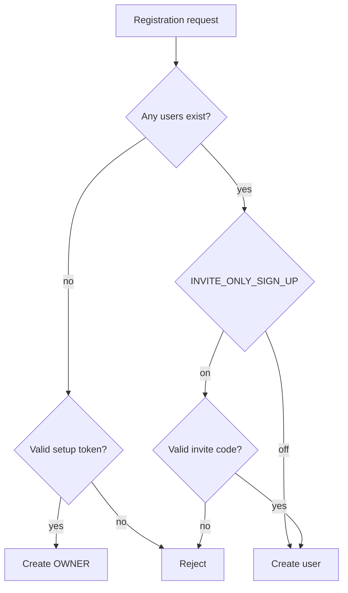

# Security policy

Konvoez is a **self-hosted, single-server** voice and text chat platform: the deployed instance is the server itself. It is meant for private communities, teams or individuals on self-managed infrastructure, not for multi-tenant SaaS. Reports are judged against the threat model below. Read it before opening a security advisory.

## Threat model

### Roles and permissions

- **`OWNER`**: the instance creator, stored as an `isOwner` flag. It is assigned only to the first registered user, always holds every permission (current and future) and sees all private rooms. The owner account cannot be transferred, modified or deleted through user management.
- **Roles**: all other capabilities come from configurable roles with granular permissions (`EPermission`): `MANAGE_SETTINGS`, `MANAGE_USERS`, `MANAGE_ROLES`, `MANAGE_INVITES`, `MANAGE_ROOMS`, `SEND_MESSAGES`, `CONNECT_VOICE`, `USE_ATTACHMENTS`, `MODERATE_MESSAGES`, `MENTION_EVERYONE`.
- **Seeded roles**: `Admin` (all permissions), `Moderator` (`MANAGE_ROOMS`, `MODERATE_MESSAGES`, `MENTION_EVERYONE`) and `User` (messaging and voice). Default roles apply to every authenticated user.
- **Private rooms** are limited to allowed roles and users; the `OWNER` always has access. In direct chats a user deletes only their own messages. In text rooms, `MODERATE_MESSAGES` or `OWNER` can delete any message.

### Instance bootstrap and registration

On a fresh install (no users in the database) the server prints a single-use `owner_setup_token` to stdout: 16 random bytes with a 5-minute TTL. The first registration must supply it to become the `OWNER`. This prevents hijacking a new instance exposed to a public network. An expired token requires a restart to issue a new one.

`INVITE_ONLY_SIGN_UP` defaults to `true`. It can be set through the environment or toggled in the admin settings by users with `MANAGE_SETTINGS` (or the `OWNER`). Invites are created with `MANAGE_INVITES`, are single-use, expire after a configurable TTL and can be bound to an email address. Expired, revoked and used invites are rejected.

### Data protection

- **Messages at rest**: text is encrypted with AES-256-GCM before it is stored. Keys are derived from `MASTER_KEY` with HKDF-SHA256; every message has its own IV and auth tag. This protects database backups and disk dumps that are obtained without the server environment.
- **Stored files**: attachments, avatars and other uploads are not encrypted by the app. Encryption is the operator's job at the storage layer (for example LUKS or S3 server-side encryption).
- **Voice and video**: WebRTC through the Mediasoup SFU, encrypted in transit with DTLS-SRTP.
- **Web Push**: optional, for direct messages. Payloads are encrypted for the browser subscription, so push services cannot read them. The payload carries a plaintext preview so the OS can render the notification; the server and the recipient device can see it. VAPID keys live on disk next to SQLite and are encrypted with `MASTER_KEY`; operators may mount their own `vapid.json`.

### Authentication

- Sessions are JWTs delivered in secure HTTP cookies. Passwords are stored as Argon2 hashes.
- Password recovery uses emailed one-time codes. See [Password recovery](PASSWORD_RECOVERY.md).
- An account with `deletedAt` set cannot log in, refresh a session, open a socket or recover its password. See [User management](USER_MANAGEMENT.md).

## In scope

- Unauthenticated access to private rooms, message streams or user details.
- Authentication or authorization bypass, such as impersonation or forged JWT cookies.
- Bypassing the `OWNER` bootstrap token, or claiming `OWNER` after the initial setup.
- Bypassing invite-only registration: missing, reused, expired or revoked codes, or ignoring email binding.
- Creating, revoking or listing invites without `MANAGE_INVITES`.
- Privilege escalation: assigning roles without `MANAGE_ROLES`, or modifying or claiming the `OWNER` account.
- Cross-user manipulation: editing another user's message, deleting messages without `OWNER` or `MODERATE_MESSAGES`, deleting another user's direct message with any role.
- Reading a private room without being an allowed user, having an allowed role or being the `OWNER`.
- Cryptographic flaws in message encryption or key derivation, such as IV reuse or ciphertext manipulation that passes GCM checks.
- Path traversal or arbitrary file read/write in avatar upload and streaming (local or S3 storage).
- Unsafe attachment serving: the sniffed MIME type, inline allowlist, `nosniff`, restrictive CSP, same-origin resource policy and `404` for every access denial must hold. Client video posters are untrusted images with size, type and pixel limits; a bad poster must not fail the upload.
- Remote code execution and SQL injection.
- Application-level DoS through resource exhaustion or asymmetric workloads, such as image bombs or leaks triggered by malformed payloads.

## Out of scope

These are not accepted as High or Critical:

- Attacks that require physical, root or shell access to the host or container.
- Intercepting the `OWNER` setup token from the console or container logs (host access already means full compromise).
- Data access gained by obtaining host environment variables (`MASTER_KEY`, `JWT_SECRET`, database credentials).
- Actions that a permission intentionally allows, such as deleting a room (`MANAGE_ROOMS`), moderating text room messages (`MODERATE_MESSAGES`), managing users, invites or settings.
- Missing TLS when the operator did not configure a reverse proxy. Production deployments are expected to use HTTPS.
- Weak operator-chosen secrets, such as a trivial `MASTER_KEY` or `JWT_SECRET`.
- DoS from network saturation or ordinary media bandwidth limits, without a software vulnerability.
- Unencrypted stored assets (see Data protection).
- Image metadata (EXIF/GPS) is kept unless an admin enables stripping, which applies only to new uploads.
- `ffmpeg` is not shipped in the runtime image. A mounted binary, its updates and its license are the operator's responsibility, and a client-supplied poster is not evidence of the video contents.

## Severity

CVSS is scored in the context of this threat model.

- **Critical / High**: unauthenticated remote access, authentication bypass, bypassing the `OWNER` setup token, registration bypass under invite-only mode, remote code execution, decrypting messages without the key, or escalating from a regular user to `Admin` / `OWNER`.
- **Medium / Low**: minor permission anomalies within the same privilege level, or issues that need already compromised administrative credentials.

## Reporting

Report vulnerabilities privately through **GitHub Security Advisories** on the repository, not through public issues. Include reproduction steps, the assumed attacker level (unauthenticated, or the user role), and a proof of concept that shows an impact beyond the intended user capabilities.
