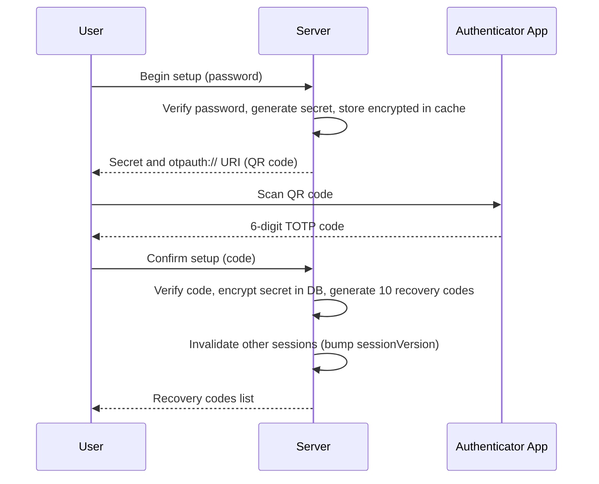
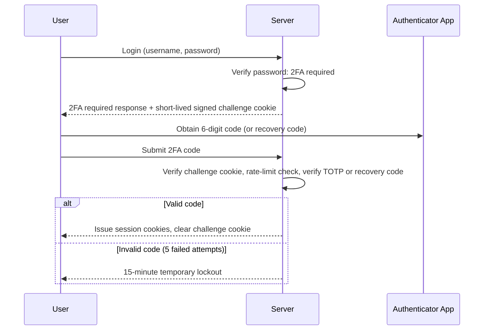

# Two-factor authentication (TOTP)

The app supports two-factor authentication (2FA) using RFC 6238 time-based one-time passwords (TOTP) and single-use recovery codes.

## Enrollment flow

Users enable 2FA from **Settings → Security**.



## Login flow

When 2FA is enabled on an account, primary authentication issues a short-lived challenge cookie instead of a full session.



## Rules and security

- **TOTP algorithm**: RFC 6238 (HMAC-SHA1, 6 digits, 30-second step) with a `±1` step window (current, previous, next).
- **Replay protection**: The server records the last used time step; a code cannot be reused within the same 30-second window.
- **Recovery codes**: Enabling 2FA or regenerating codes issues 10 random Crockford Base32 codes (10 characters, grouped as `XXXXX-XXXXX`). Each code is hashed with Argon2id; the plaintext is displayed once. Each recovery code is single-use and marked with its consumption timestamp.
- **Rate limiting**: 5 consecutive failed code attempts trigger a 15-minute lockout for 2FA verification.
- **Session invalidation**: Enabling 2FA, disabling 2FA, regenerating recovery codes, or an administrator resetting 2FA invalidates all other active sessions and live socket connections by incrementing the user's `sessionVersion`.
- **Anonymization and deletion**: Anonymizing or deleting an account purges all 2FA secrets and recovery codes.

## Administration and recovery

### Admin reset

Administrators with `MANAGE_USERS` (or the `OWNER`) can reset 2FA for any user from the user dialog in **Settings → Users**. Resetting clears the user's 2FA secret, disables 2FA, deletes all recovery codes, and revokes active sessions.

The `OWNER` account cannot be modified through the administration UI.

### Server owner recovery

If the instance owner loses access to both their authenticator app and recovery codes, 2FA can be cleared directly in the database:

```sql
update users set two_factor_secret = null, two_factor_enabled_at = null, two_factor_last_step = null where id = 1;
delete from two_factor_recovery_codes where user_id = 1;
```

After running this query, the owner can log in using only their username and password, then set up 2FA again in settings.
