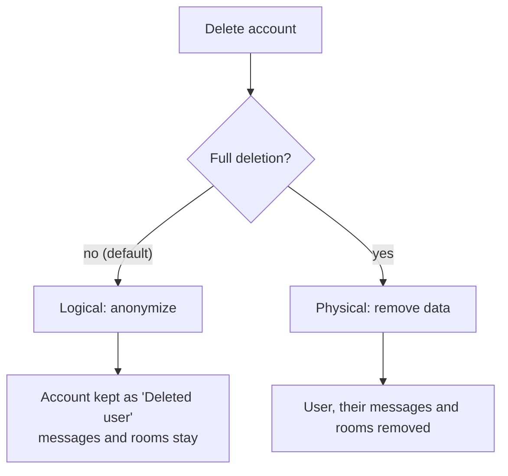

# User management

The app supports administrators managing other accounts from **Settings → Users**, and users managing their own account from **Settings → Profile**.

## Access rules

| Action                  | Requires                         |
| ----------------------- | -------------------------------- |
| Open and manage users   | `MANAGE_USERS` or `OWNER`        |
| Change a user's roles   | `MANAGE_ROLES` or `OWNER`        |
| Delete your own account | Any authenticated non-owner user |

- The `OWNER` account cannot be modified or deleted by anyone, including itself, and no one can change or delete their own account through user management.
- Users without the permission get `403`. The **Users** menu item is shown only to users who hold `MANAGE_USERS` or are the `OWNER`.
- The user directory (`GET /api/v1/users`) is available to any authenticated user and returns `GetUserSafeDto` (no email). `GetUserFullDto` (with email) appears on `GET /api/v1/auth/me`, profile self-update responses, and `user-management` endpoints for administrators with `MANAGE_USERS`.

## Roles

Administrators with `MANAGE_ROLES` assign roles to a user through checkboxes in the user dialog. Roles also control mention behavior: a role can be `mentionable`, and the `MENTION_EVERYONE` permission allows `@everyone`. See [Mentions](MENTIONS.md).

## Deleting accounts

An account can be deleted in two ways. The same two modes apply to administrators (`/api/v1/user-management/:id`) and to self-deletion (`/api/v1/profile`).

| Mode                  | Endpoint                                                  | Result                                                                                                                                                                                                                 |
| --------------------- | --------------------------------------------------------- | ---------------------------------------------------------------------------------------------------------------------------------------------------------------------------------------------------------------------- |
| **Logical** (default) | `POST …/anonymize` (`/user-management/:id` or `/profile`) | The row, roles, rooms and messages stay. Username becomes `deleted-{id}`, full name `Deleted user`, email `deleted-{id}@users.invalid`; avatar is removed, password replaced with a random hash, `deletedAt` set once. |
| **Physical**          | `DELETE …` (`/user-management/:id` or `/profile`)         | One transaction removes the user, their avatar, messages they sent, direct messages sent to them, and every room they created with its messages and avatar. Replies to removed messages lose their reply link.         |

- **Anonymized accounts** cannot log in, refresh a session, open a socket or recover a password; failures look like bad credentials or an unknown email. Both anonymization and physical deletion end every session and live connection of the user immediately.
- **Physical deletion** also removes invites, recovery codes, push subscriptions, notifications and read receipts through foreign keys. Rooms created by other people stay.
- The delete dialog has a **Full deletion** switch that is off by default; the dialog only returns the choice and the caller sends the request.
- After self-deletion the client logs out and clears the session.
- `deletedAt` is part of the public user object (`null` means active). Profile updates never set or clear it.
