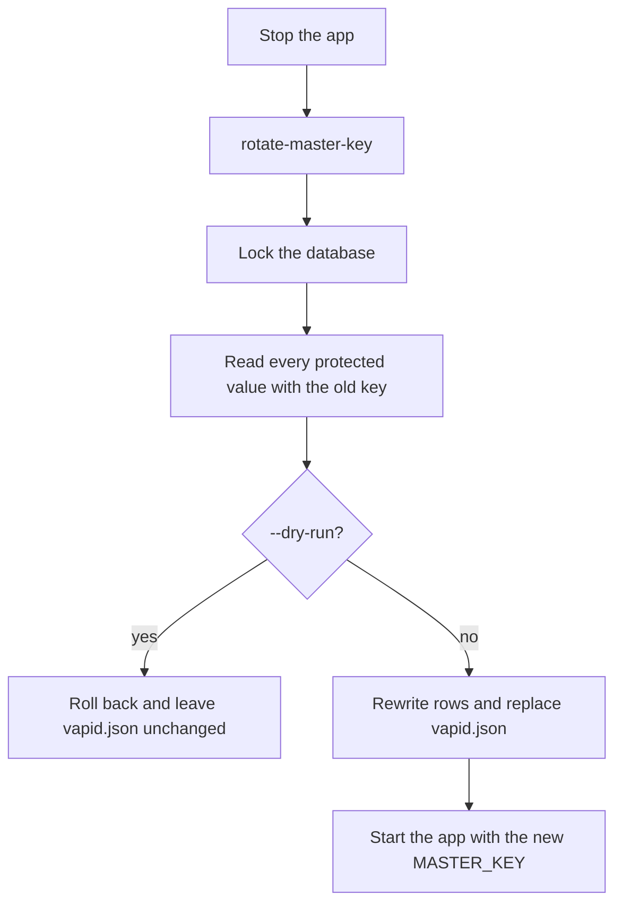

# Key rotation

`MASTER_KEY` protects data at rest. Rotation is an offline command: the app is stopped, every protected value is rewritten under the new key, then the app starts with that key.

## What the key covers

| Value                  | At rest                          | Rotation                         |
| ---------------------- | -------------------------------- | -------------------------------- |
| Message text           | Secret box                       | Re-encrypted                     |
| Search tokens          | HMAC-SHA256 trigrams of the text | Recomputed from the text         |
| TOTP secret            | Secret box                       | Re-encrypted                     |
| Recovery-code HMAC key | Secret box                       | Rewrapped; code hashes unchanged |
| VAPID key pair         | Secret box in `vapid.json`       | Re-encrypted                     |

Passwords, email codes and password-recovery codes use Argon2. Session tokens, attachments and avatars are not protected by `MASTER_KEY`.

## Upgrade

An existing instance starts this version with its current `MASTER_KEY`. That start applies the migration, which rewrites stored ciphertext with that key. Rotation runs after the migration. `MASTER_KEY` changes only after the command succeeds.

If the key cannot decrypt existing messages, the migration stops and stays pending.

## Rotation

The app service is stopped first, so it cannot write with the old key while the command runs. `OLD_MASTER_KEY` and `NEW_MASTER_KEY` come from the environment. The command does not apply migrations. It takes an immediate SQLite lock, checks every protected value with the old key, and rewrites the database in one transaction. `vapid.json` is replaced after that commit. `--dry-run` checks every value, rolls the transaction back and does not touch `vapid.json`.

```bash
docker compose stop app
docker compose run --rm --no-deps \
  -e OLD_MASTER_KEY -e NEW_MASTER_KEY \
  app node /app/backend/main.js rotate-master-key
```

`MASTER_KEY` is then set to the new key and the service is started:

```bash
docker compose up -d
```

Without Docker the same entry point is `node main.js rotate-master-key`, with the same two variables in the environment and the server stopped.



If replacing `vapid.json` fails after the database commit, the command exits non-zero and prints the `mv` command that finishes the replacement. On the next start, `vapid.json.rotate` replaces `vapid.json` only when the staged file is the one the current `MASTER_KEY` can read. A readable `vapid.json` stays in place, and so does `vapid.json.rotate`. The server does not generate new VAPID keys while `vapid.json` cannot be read.
