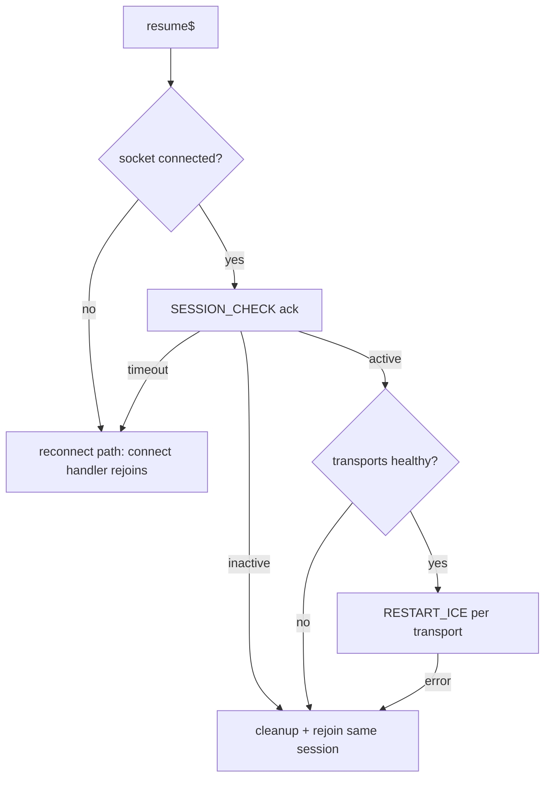

# Frontend app resume

After the device sleeps or the tab is backgrounded, sockets may look connected while their transport is dead, and events sent meanwhile are lost. The client recovers on resume.

## Resume signal

`AppResumeService.resume$` emits once per resume, with the time spent hidden (`sleptMs`). Triggers: the tab becomes visible, the page is restored from the back-forward cache (`pageshow` with `persisted`), the browser goes online. A burst of triggers is debounced into one emission.

## Sockets

`AuthSocketManager` checks every enabled socket on resume while authorized:

- A connected socket is pinged with `ESocketEvent.PING`, which every gateway acknowledges. No ack in time: `disconnect()` + `connect()`.
- A disconnected socket reconnects at once, skipping the backoff timer. The token is refreshed first through `TokenRefreshService`; an `Unauthorized` connect error still goes through the usual refresh-and-retry.

## Catch-up after reconnect

A `connect` that follows a `disconnect` (`socketReconnected$`) refetches what may have been missed:

- The open chat re-sends `JOIN` (the server forgets a dropped socket's room) and loads messages newer than the last known one, using the regular newer-page loading. A chat scrolled into history or in search mode only rejoins.
- Unread counts, direct chats and rooms are reloaded.

## Voice

- Rejoin uses the regular join flow: new transports, microphone producer from the current track, consumers for current peers.
- Camera and screen share are not restored after a rejoin, same as after a reconnect.
- A track that ended during sleep is handled by the device fallback (see [Noise suppression](NOISE_SUPPRESSION.md)).
