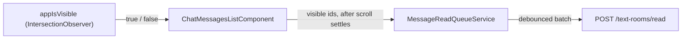

# Frontend chat list

The message list of text rooms and direct chats (`ChatMessagesListComponent`) is virtualized with [`@tanstack/angular-virtual`](https://tanstack.com/virtual/latest/docs/framework/angular/angular-virtual). Only the visible rows plus an overscan are in the DOM. Paging and unread rules: [Chat reading](../CHAT_READING.md).

## Rows

The list renders a flat array of rows built from the chat store (`chat-rows.ts`):

| Row             | Key                    | When                                        |
| --------------- | ---------------------- | ------------------------------------------- |
| Top skeleton    | `skel-top`             | Older page is loading                       |
| Unread divider  | `divider`              | Before the first unread message of the page |
| Message         | `msg:<clientId ?? id>` | Every message, oldest first                 |
| Bottom skeleton | `skel-bottom`          | Newer page is loading                       |

- Keys are stable across pages. An optimistic message and its server copy share `clientId`, so the ack does not re-measure the row.
- Rows are absolutely positioned and measured after render (`VirtualMeasureDirective`). Until then the height is estimated from the text length and, for media, from the attachment width and height (`messageMediaFrame`), the same frame that reserves the media size in the message.

## Scrolling

- The virtualizer runs with `anchorTo: 'end'`. Before the data changes it remembers the row at the top of the viewport and restores its offset afterwards, so prepending older history, skeletons appearing and rows resizing above the viewport do not move what the user reads. There is no `column-reverse` and no manual `scrollTop` compensation.
- On iOS WebKit the virtualizer does not write `scrollTop` while a finger is down, during momentum or rubber-band. It holds the correction, shifts the rendered rows by the held amount and writes once the scroll settles, so momentum is never cut.
- `followOnAppend` keeps the list at the bottom when a message arrives and the user is within 80 px of the end. Reading history is never interrupted. The user's own message always scrolls to the end.
- A short chat is pinned to the bottom: the rows container sits at the bottom of a viewport-high wrapper.
- Older and newer pages (`MESSAGE_PAGE_SIZE`, 50) are requested when the scroll position is within 2.5 viewport heights of an edge (`PREFETCH_VIEWPORTS`), once the initial position is applied and no page is loading. The check runs again after each page, so loading continues while the user is still close to the edge.
- The loaded window is not capped: rows outside the viewport are not rendered, and message data is small.
- Initial position and jumps use `scrollToIndex`: the unread divider aligned to the top, a deep-linked message centered and highlighted, or `scrollToEnd` for the latest messages. The scroll-to-bottom button scrolls to the end, or reads all and loads the latest page when newer pages exist or messages are unread.

## Read receipts

- `IsVisibleDirective` (`appIsVisible`) is a generic shared directive: it observes its host inside the nearest Taiga scroll container and emits `true` or `false` when at least `appIsVisibleThreshold` (0.5) of the host becomes visible or stops being visible. It has no knowledge of messages.
- The list keeps the ids of visible message rows. It enqueues incoming, unread, non-pending messages only while no programmatic jump is running and the virtualizer is not scrolling. When scrolling settles it flushes the ids that are still visible, so messages that only flew by are not marked read.
- Rows removed by the virtualizer drop out of the visible set.
