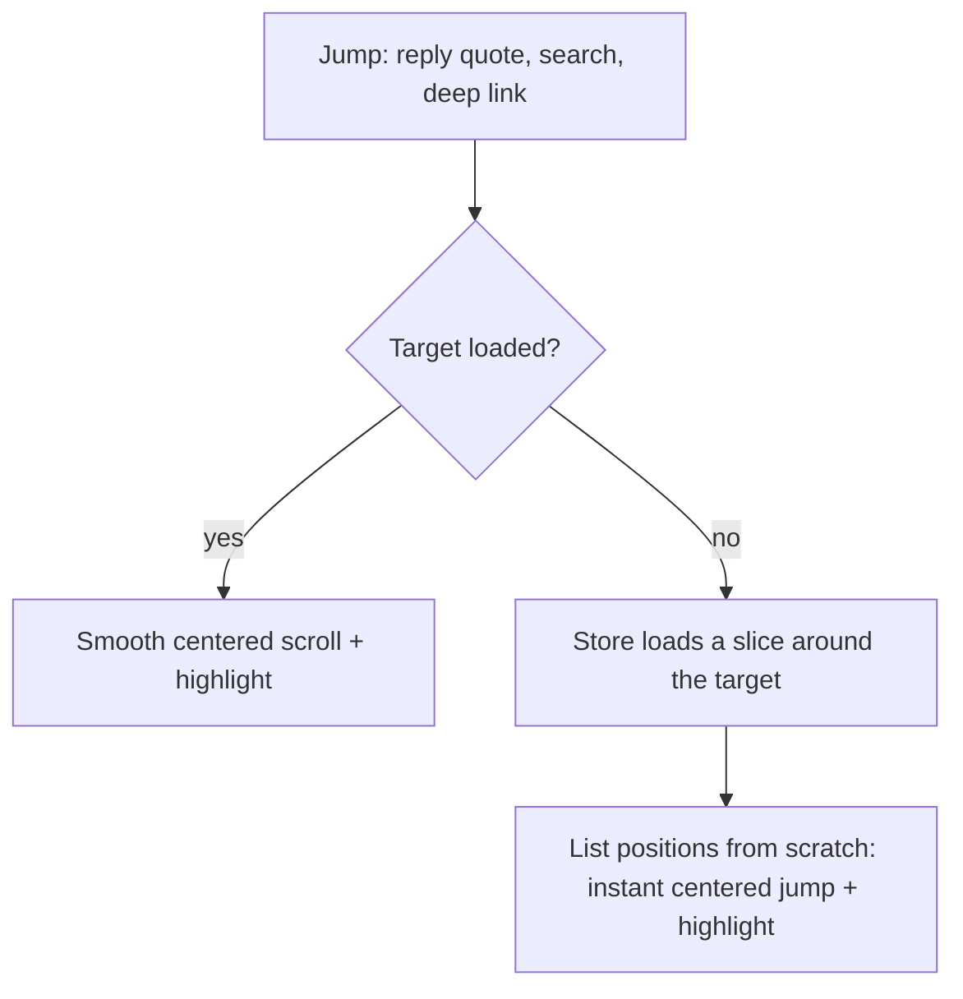
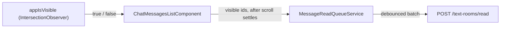

# Frontend chat list

The message list of text rooms and direct chats (`ChatMessagesListComponent`) is virtualized with [`@tanstack/angular-virtual`](https://tanstack.com/virtual/latest/docs/framework/angular/angular-virtual). Only the visible rows plus an overscan are in the DOM. Paging and unread rules: [Chat reading](../CHAT_READING.md).

## Rows

| Row             | Key                    | When                            |
| --------------- | ---------------------- | ------------------------------- |
| Message         | `msg:<clientId ?? id>` | Every loaded message            |
| Unread divider  | `divider`              | Before the first unread message |
| Top skeleton    | `skel-top`             | An older page is loading        |
| Bottom skeleton | `skel-bottom`          | A newer page is loading         |

- Keys are stable across pages. An optimistic message and its server copy share `clientId`, so the ack keeps the row.
- Rows are measured after render. Until then the height is estimated from the text and the media frame.

## Inverted list

- The scroll container and every row use `scaleY(-1)`. The newest row is first, the scroll start is the visual bottom, and a short chat sits there without extra layout.
- Older pages are added at the far end of the scroll range, so they never shift the viewport and an iOS fling runs on through new history.
- The virtualizer anchors the row at the scroll position, so newer pages and live messages do not move what the user reads. At the live bottom a new message stays in view. The user's own message always scrolls to the bottom.
- Wheel and keyboard (arrows, PageUp/PageDown, Home/End) follow the visual direction. Touch and the scrollbar work natively.
- The container uses a thin native scrollbar instead of `tui-scrollbar`, whose custom bars do not render inside a transformed container.
- The DOM order is newest first, so screen readers read in reverse. Selection, menus and tooltips work as usual.

## Loading and jumps

- Pages of `MESSAGE_PAGE_SIZE` load in advance, a few screens before an edge, and keep loading while the user stays close. The loaded window is not capped.
- No page is requested while a jump or a window reload is in progress. Switching or leaving a chat cancels its pending loads, so a late response never lands in another chat.

- On open the list shows the unread divider at the top, a deep-linked message centered, or the latest messages.
- The scroll-to-bottom button scrolls to the latest messages, or reads all and loads the latest page when newer pages exist or messages are unread.

## Read receipts

- `IsVisibleDirective` (`appIsVisible`) observes its host inside `appIsVisibleRoot` (the list passes its scroll container; otherwise the viewport) and emits when visibility crosses `appIsVisibleThreshold`.
- The list enqueues incoming unread messages that stay visible once scrolling and jumps settle, so messages that only flew by are not marked read.

## Reply shortcuts

Both gestures set reply to that message in `ChatStore`. They ignore outgoing messages and interactive controls (avatars, reactions, attachments, links, quote replies, user mentions), so audio scrubbing keeps its own drag. Selecting a message to reply or edit auto-focuses the chat composer with the cursor at the end of the text. On a touch device that focus is the composer itself and runs inside the reply or edit gesture, so the virtual keyboard opens with the caret.

- **Double-click**: the second click on the bubble or the empty space beside it. A touch double-tap does not reply.
- **Swipe** (`appSwipeToReply`): a horizontal drag in either direction. Vertical scrolling is unaffected.
