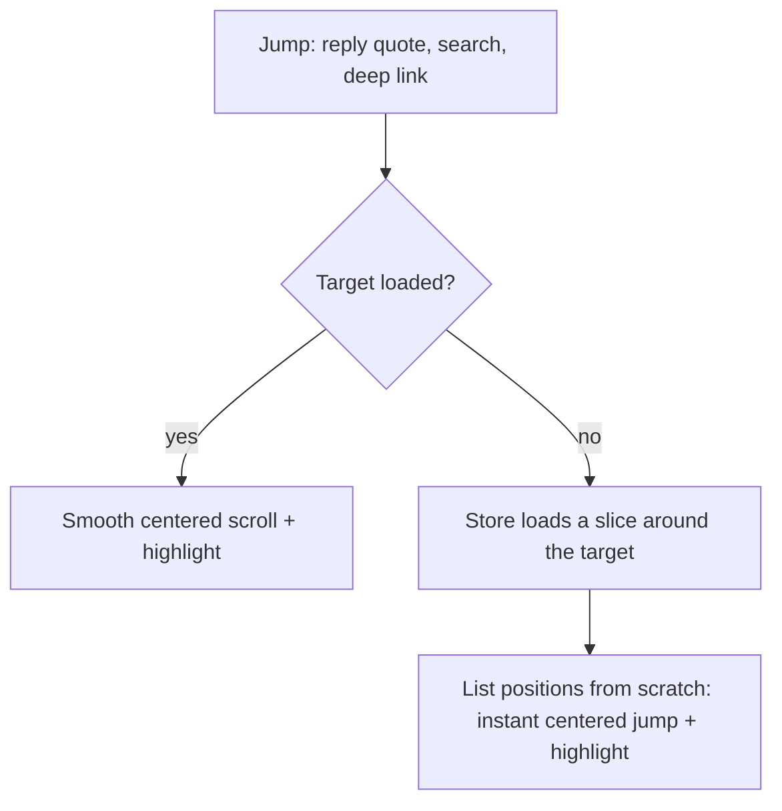
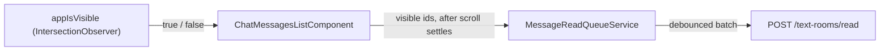

# Frontend chat list

The message list of text rooms and direct chats (`ChatMessagesListComponent`) is virtualized with [`@tanstack/angular-virtual`](https://tanstack.com/virtual/latest/docs/framework/angular/angular-virtual). Only the visible rows plus an overscan are in the DOM. Paging and unread rules: [Chat reading](../CHAT_READING.md).

## Rows

| Row             | Key                    | When                            |
| --------------- | ---------------------- | ------------------------------- |
| Message         | `msg:<clientId ?? id>` | Every loaded message            |
| Unread divider  | `divider`              | Before the first unread message |
| Top skeleton    | `skel-top`             | An older page is loading        |
| Bottom skeleton | `skel-bottom`          | A newer page is loading         |

- Keys are stable across pages. An optimistic message and its server copy share `clientId`, so the ack keeps the row.
- Rows are measured after render. Until then the height is estimated from the text and the media frame.

## Inverted list

- The list is flipped: the scroll container and every row use `scaleY(-1)`. The newest row is first, and the scroll start is the visual bottom.
- Older pages are added at the far end of the scroll range, so they never shift the viewport and an iOS fling runs on through new history.
- The virtualizer anchors the row at the scroll position, so newer pages and live messages do not move what the user reads. At the live bottom a new message stays in view. The user's own message always scrolls to the bottom.
- A short chat sits at the bottom without extra layout.
- Wheel and keyboard (arrows, PageUp/PageDown, Home/End) are mapped to the visual direction. Touch and the scrollbar work natively.
- The container uses a thin native scrollbar instead of `tui-scrollbar`, whose custom bars do not render inside a transformed container.
- Selection, menus and tooltips work as usual. The DOM order is newest first, so screen readers read in reverse.

## Loading and jumps

- Pages of `MESSAGE_PAGE_SIZE` load in advance, a few screens before an edge, and keep loading while the user stays close. The loaded window is not capped.
- No page is requested while a jump or a window reload is in progress.

- On open the list shows the unread divider at the top, a deep-linked message centered, or the latest messages.
- The scroll-to-bottom button scrolls to the latest messages, or reads all and loads the latest page when newer pages exist or messages are unread.

## Read receipts

- `IsVisibleDirective` (`appIsVisible`) is a generic directive. It observes its host inside `appIsVisibleRoot` (the list passes its scroll container; without it, the viewport) and emits when the host becomes visible or hidden by `appIsVisibleThreshold`.
- The list enqueues incoming unread messages that stay visible once scrolling and jumps settle, so messages that only flew by are not marked read.
