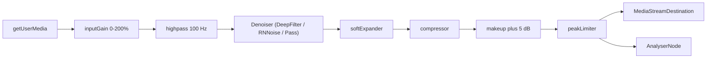
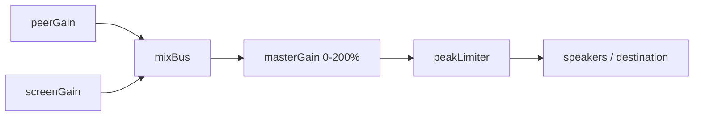

# Frontend noise suppression and audio controls

Mic capture, noise suppression engines, playback dynamics, and device test pipeline. Session flow: [VOICE.md](./VOICE.md).

## Processors & Capabilities

Konvoez supports 4 selectable noise suppression modes:

- **`deepfilter` (DeepFilterNet 3)**: State-of-the-art deep learning model running in WebAssembly. Requires WASM SIMD support (`isSimdSupported()`) and 48 kHz sample rate. Wasm binary (`df_bg.wasm`) and worklet (`worklet.js`) come from `@lofcz/deepfilternet-web` and are served from `/assets/deepfilternet/`.
- **`rnnoise` (RNNoise)**: Recurrent neural network suppressor for stationary and non-stationary noises (e.g. keyboard clicks). Runs via `@sapphi-red/web-noise-suppressor` with SIMD or standard fallback.
- **`browser`**: Standard browser `MediaTrackConstraints` `noiseSuppression: true`.
- **`off`**: No noise suppression applied.

> [!NOTE]
> Speex DSP has been dropped completely in favor of DeepFilterNet 3 and RNNoise.

### Fallback Hierarchy

If the preferred processor cannot run:

1. **DeepFilterNet 3** checks for WASM SIMD capability and 48 kHz sample rate. If SIMD is unsupported, loading fails, or sample rate differs, it falls back to **RNNoise**.
2. **RNNoise** requires 48 kHz. If initialization fails or context is not 48 kHz, it falls back to **Off**.
3. **Runtime CPU overload protection**: When running DeepFilterNet 3 on supported browsers, `MicrophoneService` monitors real-time audio thread capacity via `AudioContext.renderCapacity`. If average render load exceeds 85% across consecutive measurement windows, `MicrophoneService` automatically downgrades the active processor to **RNNoise** and alerts the user with a notification.

## CSP Requirements

Running WebAssembly noise suppression worklets requires the following Content Security Policy:

```http
script-src 'self' 'wasm-unsafe-eval';
```

`'wasm-unsafe-eval'` enables compilation of WebAssembly modules inside web workers/worklets without permitting arbitrary JavaScript `eval()`.

## Capture Pipeline

`MicrophoneService` operates an `AudioContext` at 48 kHz. Changing the active denoiser or echo cancellation recreates the denoiser node in-place without resetting the `MediaStreamDestination` track sent to mediasoup, avoiding stream renegotiation or audio dropouts.



| Stage                  | Role                                                                                                                                                                                                                    |
| ---------------------- | ----------------------------------------------------------------------------------------------------------------------------------------------------------------------------------------------------------------------- |
| `inputGain`            | Digital microphone preamp gain from 0% to 200% (default 100%). Sits before any filtering so low-gain mics are boosted before noise gating.                                                                              |
| Highpass 100 Hz, Q 0.7 | Desk rumble and low-frequency HVAC attenuation before the model.                                                                                                                                                        |
| Denoiser               | Active noise suppressor (`DeepFilterWorkletNode` or `RnnoiseWorkletNode`). When `browser` or `off` is selected, audio passes straight to the dynamics processor.                                                        |
| Expander               | Closes pauses. Adaptive noise floor over ~2 s (eight 250 ms windows): opens near floor + 14 dB, closes near floor + 8 dB, hold 150 ms, attack 5 ms, release 120 ms, max cut about −40 dB, lookahead 240 samples (~5 ms) |
| Compressor             | Gentle level ride: threshold −26 dB, knee 16 dB, ratio 2.5, attack 12 ms, release 250 ms.                                                                                                                               |
| Makeup +5 dB           | Lifts speech the compressor did not touch.                                                                                                                                                                              |
| Limiter                | Lookahead 128 samples (~2.7 ms) tracked with a sliding maximum, ceiling −1 dBFS, release 50 ms.                                                                                                                         |

## Playback Pipeline

`SpeakerService` manages remote audio mixing and output. `masterGainNode` allows adjusting master output volume from 0% to 200%. It is positioned before the playback limiter so boosting master volume cannot hard-clip the audio output.



## Microphone Test Pipeline

`MicTestService` provides an isolated test pipeline used in Settings:

- Own isolated `AudioContext` and dynamic pipeline that mimics `MicrophoneService`.
- Real-time RMS audio metering (0–100%) via `requestAnimationFrame` and `AnalyserNode`.
- Supports speaker sink routing via `HTMLAudioElement.setSinkId` (where supported).
- Automatically halts when the page hides, the test is unmounted, or the user joins a voice room.

## Settings Persistence

All hardware and audio capture/playback preferences are stored in `LOCAL_SETTINGS` (`konvoez-local-settings`) and managed via `SettingsStore` (`localSettingsSchema`):

- `audioInput` & `audioOutput` (device IDs and labels)
- `noiseProcessor`: `'deepfilter' | 'rnnoise' | 'browser' | 'off'` (default `'deepfilter'`)
- `inputGain`: `0.0..2.0` (default `1.0`)
- `outputVolume`: `0.0..2.0` (default `1.0`)
- `echoCancellation`: `boolean` (default `true`)

Session-specific mute state (`microphoneMuted`, `speakerMuted`) and per-user gain levels (`peerGainLevels`, `peerScreenGainLevels`) remain in `VoiceAudioPreferencesStore`.

## Tests

- `microphone.service.spec.ts`: graph initialization, switching processors, fallback to RNNoise on error and CPU overload, echo cancellation updates.
- `speaker.service.spec.ts`: master output gain (0–200%), limiter integration, sink routing.
- `mic-test.service.spec.ts`: isolated test start/stop/restart, sink routing, auto-stop on session start.
- `settings.store.spec.ts`: hydration, persistence, and service routing for audio preferences.
- `settings-devices.component.spec.ts`: UI bindings, sliders, SIMD capability disables.
- `voice-di-cycle.spec.ts`: guards against circular dependency regressions.
