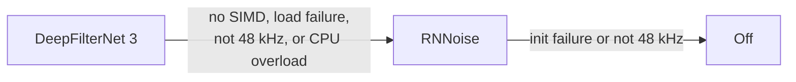
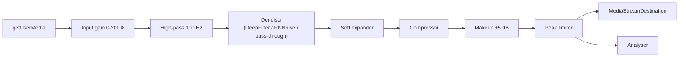
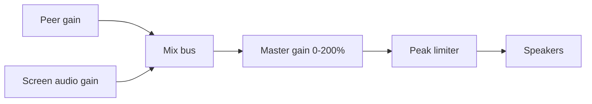

# Frontend noise suppression and audio controls

Microphone capture, noise suppression, playback mixing and the device test. Session flow: [Voice](./VOICE.md).

## Noise suppression modes

| Mode (`noiseProcessor`) | Description                                                                                                                               |
| ----------------------- | ----------------------------------------------------------------------------------------------------------------------------------------- |
| `deepfilter` (default)  | DeepFilterNet 3, a deep-learning model running in WebAssembly. Requires WASM SIMD and a 48 kHz context.                                   |
| `rnnoise`               | RNNoise recurrent network (`@sapphi-red/web-noise-suppressor`), good for keyboard clicks and other non-stationary noise. Requires 48 kHz. |
| `browser`               | The browser's built-in `noiseSuppression` constraint.                                                                                     |
| `off`                   | No suppression.                                                                                                                           |

### Fallbacks



`MicrophoneService` watches the audio thread load (`AudioContext.renderCapacity`). If DeepFilterNet 3 stays above 85% over consecutive windows, the app downgrades to RNNoise and notifies the user.

### Assets and CSP

DeepFilterNet's WASM binary and worklet are served from `/assets/deepfilternet/`. These files and the RNNoise assets are cache-busted with version query parameters (`withVersion`). The vendored DeepFilterNet worklet is patched with a `dispose` message to free native WASM state, so it is versioned with the app release.

Running WASM in worklets requires this Content Security Policy directive:

```http
script-src 'self' 'wasm-unsafe-eval';
```

## Capture pipeline

`MicrophoneService` runs one 48 kHz `AudioContext`. Changing the denoiser or echo cancellation swaps the denoiser node in place, so the track sent to mediasoup is not renegotiated and audio does not drop.



| Stage      | Role                                                                                   |
| ---------- | -------------------------------------------------------------------------------------- |
| Input gain | Digital preamp before any filtering, so quiet microphones are boosted ahead of gating. |
| High-pass  | Removes desk rumble and low-frequency noise before the model.                          |
| Denoiser   | The selected suppressor. `browser` and `off` pass audio straight through.              |
| Expander   | Closes pauses using an adaptive noise floor estimated over about 2 seconds.            |
| Compressor | Gentle level riding.                                                                   |
| Makeup     | Lifts speech the compressor did not touch.                                             |
| Limiter    | Lookahead peak limiter that prevents clipping.                                         |

## Playback pipeline

`SpeakerService` mixes remote audio. The master gain (0-200%) sits before the limiter, so boosting the volume cannot hard-clip the output.



## Microphone test

`MicTestService` powers the test in Settings. It uses its own audio context and a pipeline that mirrors `MicrophoneService`, shows a live input level, and can route to the selected speaker (`setSinkId`, where supported). The test stops automatically when the page is hidden, the test is closed or the user joins a voice room.

## Settings

Device and audio preferences persist in local storage (`konvoez-local-settings`, `SettingsStore`): input and output devices, `noiseProcessor`, `inputGain`, `outputVolume` and `echoCancellation`. Mute and deafen state and per-user gains stay in `VoiceAudioPreferencesStore`.

- When a selected device is unavailable, active capture and playback switch to an available fallback. Reconnecting the selected device returns it to use.
- Automatic switches are announced with a toast; the settings device lists refresh when hardware changes.
