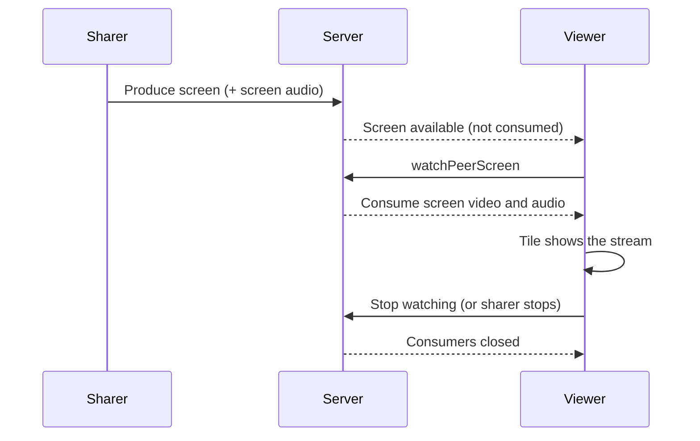

# Frontend streaming

Camera and screen sharing run on top of the voice stack ([Voice](./VOICE.md)).

## Subscribe model

| Kind                      | Published        | Remote video               | Audio                                                                    |
| ------------------------- | ---------------- | -------------------------- | ------------------------------------------------------------------------ |
| Microphone                | While in session | -                          | Automatic, through `PeerPlaybackService`                                 |
| Camera                    | User toggle      | Automatic                  | Video only, through `PeerVideoService`                                   |
| Screen (+ optional audio) | User toggle      | Opt-in (`watchPeerScreen`) | Video through `PeerVideoService`, audio through `PeerScreenAudioService` |

- Each user has at most one camera and one screen stream; a room allows up to 4 video producers. Senders use VP8.
- Resolution and frame rate come from settings and the shared start dialog. The screen button is hidden when `getDisplayMedia` is unavailable.
- Stopping a screen share closes its video producer, and the server closes the paired `screen-audio` producer. Duplicate closes are treated as success, so stopping never hangs.

## Services

| Service                                        | Responsibility                                                                            |
| ---------------------------------------------- | ----------------------------------------------------------------------------------------- |
| `MediasoupSessionService`                      | Device, transports, produce and consume.                                                  |
| `PeerVideoService`                             | Remote tracks, available screens (`availableScreens`), watched users (`watchingUserIds`). |
| `ScreenWatchService`, `ConsumerRegistry`       | Opt-in consumption of screen video.                                                       |
| `LocalScreenPreviewService`                    | Pauses the local screen preview while the tab is hidden or blurred; publishing continues. |
| `VoiceRoomViewService`                         | Layout (grid or theatre), chrome and focus.                                               |
| `VoiceRoomTilesService`, `buildVoiceRoomTiles` | Tile view model: voice-only, camera, screen or camera + screen as separate 16:9 tiles.    |
| `VoiceRoomActionsService`                      | Tile actions: watch or stop watching a screen, screen volume.                             |

## Theatre mode

`VoiceRoomViewService` switches the layout between `grid` and `theatre`. In theatre the grid is unmounted: a strip of mini-tiles sits beside a stage with the focused stream (`theatreFocus: { peerId, stream }`).

- The focus is sticky; if the focused tile disappears, another stream takes over.
- `showGrid()` returns to the grid. The layout resets when the session changes (hangup, leave, logout, room switch).
- Group rooms and direct calls both render through `app-voice-room-shell`, which projects `app-voice-room-overlay` into the grid or theatre component. Controls live in `voice-room-controls-bar`.
