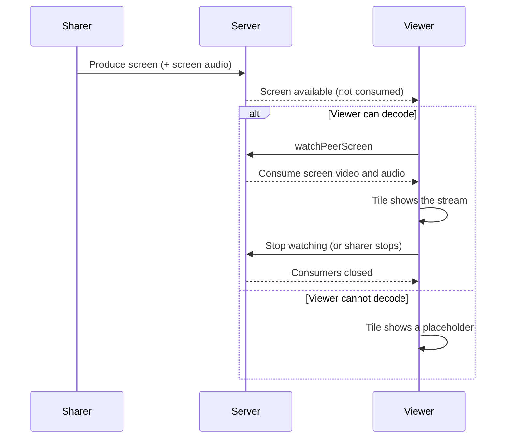
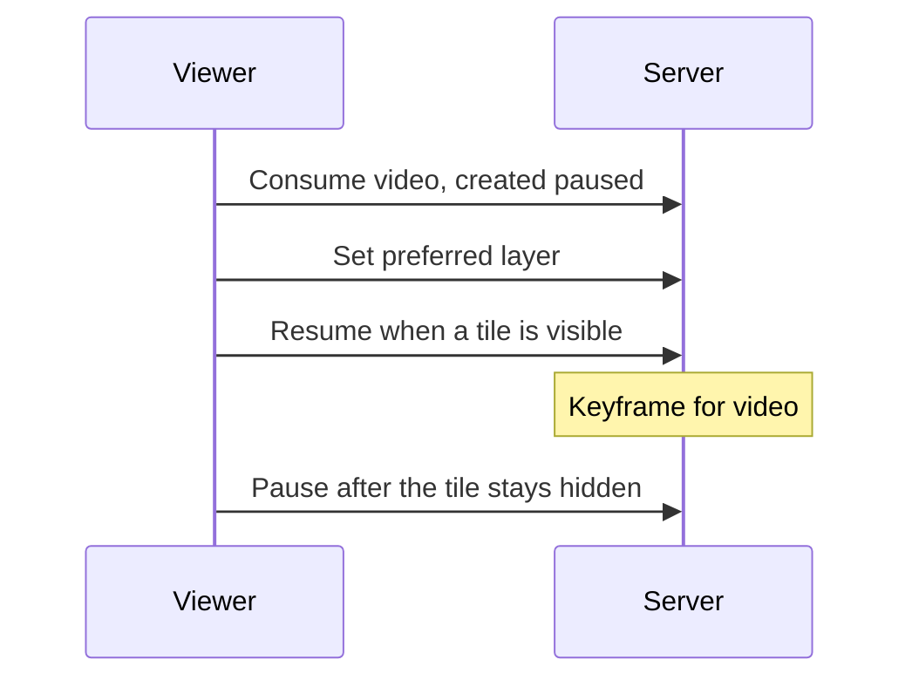

# Frontend streaming

Camera and screen sharing run on top of the voice stack ([Voice](./VOICE.md)).

## Subscribe model

| Kind                      | Published        | Remote video               | Audio                                                                    |
| ------------------------- | ---------------- | -------------------------- | ------------------------------------------------------------------------ |
| Microphone                | While in session | -                          | Automatic, through `PeerPlaybackService`                                 |
| Camera                    | User toggle      | Automatic                  | Video only, through `PeerVideoService`                                   |
| Screen (+ optional audio) | User toggle      | Opt-in (`watchPeerScreen`) | Video through `PeerVideoService`, audio through `PeerScreenAudioService` |

- Each user has at most one camera and one screen stream; a room allows up to 4 video producers. Camera and screen each offer AV1, H.264, VP9 or VP8, in that order. A codec is offered only when the loaded mediasoup device can send it, and H.264 and AV1 also require the sender. The server does not transcode.
- When no codec is saved, the start dialog selects hardware AV1, then hardware H.264, then VP9, then VP8 for the current resolution, frame rate and content mode. It keeps updating that choice until the user picks a codec, and marks the hardware option. A saved choice is kept while that codec is still offered. H.264 is published as Constrained Baseline. High is published only when the probe has found that Baseline is not a hardware encoder, High is, and the router offers it. On Windows the desktop app enables hardware AV1 encode when the GPU has one ([desktop guide](../../apps/desktop/README.md#video-encode)).
- The camera start dialog lists video inputs and previews the selected camera until the dialog closes. The choice is stored and reused on the next start; a missing device falls back to the first camera. Switching cameras during a live broadcast is not supported.
- The start dialog sets the max resolution and frame rate, a bitrate cap, and either up to two additional simulcast layers or an SVC mode. Changing the max selects the preset closest to half that height at the same frame rate; a tie uses the lower preset. The recommended cap is the sum of the per-layer recommendations, shared across the published layers, and is lower for VP9 and AV1 than for H.264 and VP8. For VP9 and AV1 that sum includes each spatial layer. H.264 and VP8 can add simulcast layers. VP9 and AV1 publish one encoding in `L1T3`, `L2T3_KEY` or `L3T3_KEY` (two spatial layers by default, always three temporal layers). Screen share also sets content mode, Game by default. Text keeps the resolution and may drop the frame rate. Game keeps the frame rate and may drop the resolution, and uses a higher recommended cap. The screen button is hidden when `getDisplayMedia` is unavailable.
- In the desktop app, native screen audio arrives as PCM from the main process and is played into the shared audio track through an AudioWorklet. When the main process falls back to system loopback, the sharer sees a warning that the broadcast includes other participants and may echo. The capture modes are described in the [desktop guide](../../apps/desktop/README.md#screen-share-audio).
- Publish sorts simulcast layers low to high, scales each one from the captured height, and drops a layer the capture cannot reach. An SVC encoding scales inside one stream: half and quarter of the captured height. The streamer's cap, the admin ceiling `STREAM_MAX_BITRATE_KBPS`, and the current quality tier bound the total budget; the tier cap is applied on every simulcast layer and on the single SVC encoding. When the browser does not apply the requested encodings, the share continues and the client shows one warning. AV1 spatial switching depends on the router receiving the Dependency Descriptor extension; without it AV1 stays on one spatial layer.
- A viewer picks Auto or one of the published layers by resolution and frame rate, from the button beside the screen volume on the tile and in theatre. The choice is global. A stream without that layer uses the nearest one not above it. The button is shown only while that stream has more than one layer. Auto follows the largest visible tile and, at the same resolution, the higher frame rate. The client asks the server for that spatial layer and does not otherwise limit incoming bandwidth. For an SVC stream the server also selects the highest temporal layer.
- A video consumer is created paused. It resumes when at least one of its tiles is on screen and the tab is visible. Hiding every tile, or hiding the tab, pauses it after a short delay. Resume applies the layer first, and the server requests a keyframe. Audio consumers stay active.
- Stopping a screen share closes its video producer, and the server closes the paired `screen-audio` producer. Duplicate closes are treated as success, so stopping never hangs.

## Services

| Service                                        | Responsibility                                                                                |
| ---------------------------------------------- | --------------------------------------------------------------------------------------------- |
| `MediasoupSessionService`                      | Device, transports, produce and consume.                                                      |
| `PeerVideoService`                             | Remote tracks, available screens (`availableScreens`), watched users (`watchingUserIds`).     |
| `ScreenWatchService`, `ConsumerRegistry`       | Opt-in consumption of screen video. The registry keeps the signalled layer list per consumer. |
| `RemoteVideoViewService`                       | Viewer quality, tile size, visibility, pause and resume of video consumers.                   |
| `LocalScreenPreviewService`                    | Pauses the local screen preview while the tab is hidden or blurred; publishing continues.     |
| `VoiceRoomViewService`                         | Layout (grid or theatre), chrome and focus.                                                   |
| `VoiceRoomTilesService`, `buildVoiceRoomTiles` | Tile view model: voice-only, camera, screen or camera + screen as separate 16:9 tiles.        |
| `VoiceRoomActionsService`                      | Tile actions: watch or stop watching a screen, screen volume.                                 |

## Theatre mode

`VoiceRoomViewService` switches the layout between `grid` and `theatre`. In theatre the grid is unmounted: a strip of mini-tiles sits beside a stage with the focused stream (`theatreFocus: { peerId, stream }`).

- The focus is sticky; if the focused tile disappears, another stream takes over.
- `showGrid()` returns to the grid. The layout resets when the session changes (hangup, leave, logout, room switch).
- Group rooms and direct calls both render through `app-voice-room-shell`, which projects `app-voice-room-overlay` into the grid or theatre component. Controls live in `voice-room-controls-bar`.
