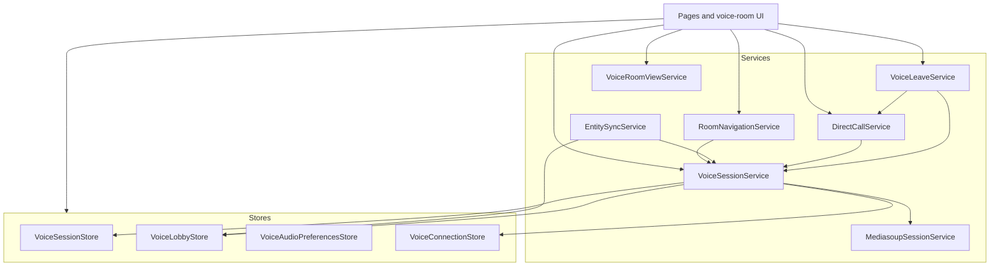
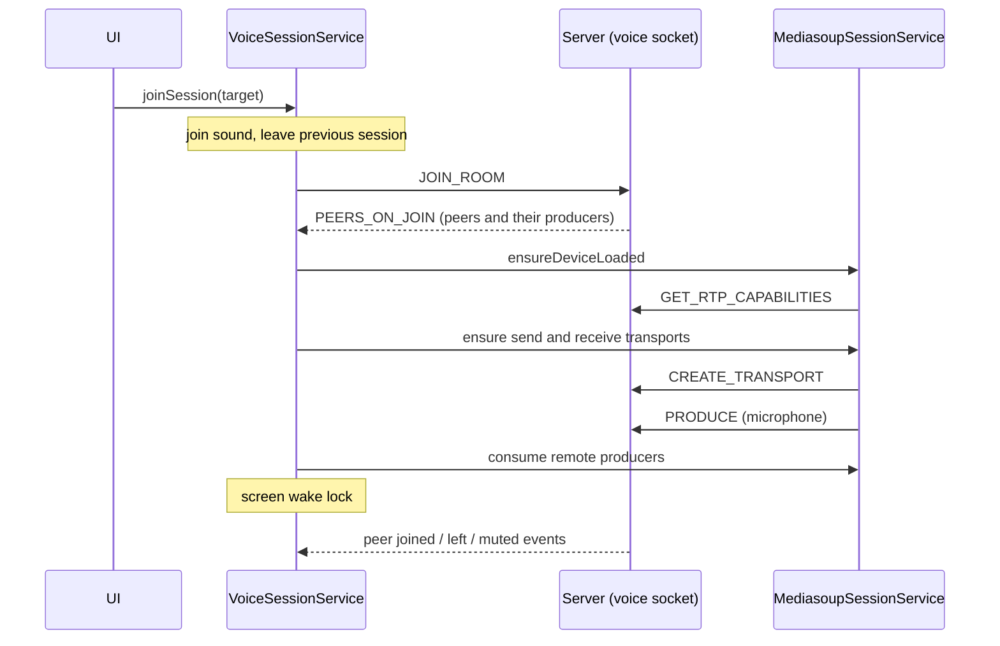
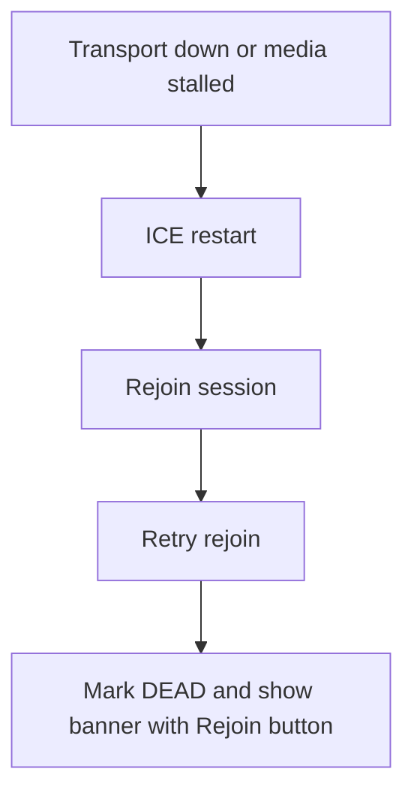

# Frontend voice

Group voice rooms and direct calls share one media stack. Signaling and SFU: [Networking](../NETWORKING.md). Camera and screen: [Streaming](./STREAMING.md). Microphone processing: [Noise suppression](./NOISE_SUPPRESSION.md).

## Layers

Signal stores hold state (session, lobby presence, audio preferences). Sockets, mediasoup and audio pipelines live in services; stores never hold `Device`, `Transport` or `AudioNode` objects.

| Concern                                  | Owner                                          |
| ---------------------------------------- | ---------------------------------------------- |
| Active session and its peers             | `VoiceSessionStore`                            |
| Connection health, recovery, liveness    | `VoiceConnectionStore`                         |
| Who is in which group voice room         | `VoiceLobbyStore`                              |
| Lobby sync (snapshot and revisions)      | `EntitySyncService`                            |
| Room navigation and selection            | `RoomNavigationService`                        |
| Mute, deafen, per-peer gains             | `VoiceAudioPreferencesStore`                   |
| Join and leave media                     | `VoiceSessionService`                          |
| Call signaling, `callWithUserId`, rejoin | `DirectCallService`                            |
| Hangup button                            | `VoiceLeaveService`                            |
| Audio device changes in settings         | `AUDIO_DEVICE_HANDLER` → `VoiceSessionService` |
| Theatre, chrome, fullscreen              | `VoiceRoomViewService`                         |
| Grid peer list                           | `VoiceSessionPeersService`                     |

## Join flow

A session is joined for a `GROUP_ROOM` (through room navigation) or a `DIRECT_CALL` (through `DirectCallService`: call, accept, rejoin).

- `JOIN_ROOM`, `CREATE_TRANSPORT` and `PRODUCE` use a longer timeout (10 s) than other acknowledged events (5 s); `PRODUCE` is retried once.
- While joining, `VoiceSessionStore.joiningTarget` is set and used by the UI.
- After a reconnect the stored session is rejoined. On app resume the session is checked with the server and either refreshed (ICE restart) or rejoined: [App resume](APP_RESUME.md).
- Hangup goes through `VoiceLeaveService.leaveActiveVoice()`: a direct call is left via `DirectCallService`, otherwise via `VoiceSessionService`. Switching sessions leaves the previous one automatically.

## Lobby

`VoiceLobbyStore` shows who is in each group voice room, even for users who are not in a session (direct calls are excluded).

- On voice socket connect, `EntitySyncService` loads a snapshot of all peers, then applies live join, leave and mute events.
- Events carry a server `epoch` and a monotonic `revision`. A gap, a new epoch or a reconnect triggers a resync; events are buffered until the lobby is synced, and stale ones are dropped.
- The client also resyncs when the tab becomes visible, the browser goes online, and every 60 seconds while visible.
- When a group room is deleted, the server sends `ROOM_CLOSED`: the client shows a toast, leaves the session and, if that room is open, navigates home.

## Audio

- **Microphone**: `MicrophoneService` builds the capture pipeline. Input level is an in-app `GainNode` only; browser `autoGainControl` stays off so Chromium does not change the OS microphone volume. Mute is applied to the producer track and stored in `VoiceAudioPreferencesStore`. Mute and deafen changes are sent to session peers and, through entity sync, to the lobby.
- **Device changes**: On device connect or disconnect, the client re-evaluates the active microphone, camera and audio output. It prefers the selected device (matching by id or label), then browser `communications` and `default` devices; the camera falls back to the first available camera. A toast appears when the active device changes.
- **Remote audio**: consumed tracks play through `PeerPlaybackService` (deafen combined with per-peer gain).
- **Speaking indicator**: `AudioActivityService` polls the registered analysers; the local analyser is registered only while the mic is unmuted in an active session.
- **Sounds**: capture, playback and UI sound effects use separate audio contexts; resuming them after a user gesture is handled by `AudioContextResumeService`. Effects are synthesized with Web Audio (positive cues rise, negative cues fall): join/leave, mute/unmute, deafen/undeafen, stream start/stop for local and remote peers, and connection lost/restored cues.

### Adaptive audio

The voice quality tier describes network throughput and packet health, but quality alone does not describe connection health or media liveness. `VoiceQualityService` polls sender WebRTC statistics (`remote-inbound-rtp`) and server producer scores every 2 seconds to adapt outgoing media. Because Mediasoup audio consumers ignore `setPriority`, sender-side uplink adaptation is the sole mechanism ensuring voice intelligibility.

- **Base bitrate**: `VOICE_MAX_BITRATE_KBPS` (8–384, default 64 kbit/s). Changes apply on the next microphone produce or reconnect; receivers play Opus as-is.
- **Tiers and protection**:

| Tier | Name        | Factor                | Video protection                                         |
| ---- | ----------- | --------------------- | -------------------------------------------------------- |
| 0    | `EXCELLENT` | 1.0                   | Uncapped                                                 |
| 1    | `GOOD`      | 0.625                 | Capped at 1.2 Mbit/s                                     |
| 2    | `UNSTABLE`  | 0.375                 | Capped at 400 kbit/s                                     |
| 3    | `BAD`       | 0.25 (floor 8 kbit/s) | Paused locally (`producer.pause()`, resumed on recovery) |

- **Hysteresis**: degradation (loss ≥ 5%, RTT ≥ 300 ms, jitter ≥ 50 ms, score ≤ 7) steps down after 2 bad samples; recovery requires 8 stable samples, a 10 s dwell time, and a 20% margin.

### Connection health

Media liveness and transport health operate independently from adaptive quality. `VoiceConnectionStore` derives connection states from socket status, transport ICE/DTLS states, client watchdog counters, device mute states, and server eviction.

| State          | Condition                                                                       | Indicator colour      |
| -------------- | ------------------------------------------------------------------------------- | --------------------- |
| `null`         | No active session                                                               | —                     |
| `CONNECTED`    | All transports healthy and socket connected                                     | Green or info         |
| `DEGRADED`     | Bad or unstable quality tier, mic error, hardware mic muted, or audio suspended | Yellow or tier colour |
| `RECONNECTING` | Transport connecting, disconnected, media stalled, or session recovering        | Grey                  |
| `DISCONNECTED` | Socket down or transport failed or closed                                       | Red                   |
| `DEAD`         | Recovery attempts exhausted or session evicted                                  | Red                   |

Silent media death (such as firewall or UDP drops) is detected by a client watchdog comparing transport candidate-pair byte counters. Unhealthy states trigger an escalation ladder:

## Direct calls

`DirectCallService` handles call signaling. The UI lives on `/direct/:id` (`DirectComponent` with `app-voice-room-shell`) and in the sidebar. The user dialog offers direct-message navigation, call initiation and per-user volume. The grid and overlay are shared with group rooms (`shared/components/voice-room/`).

## Code map

- Stores: `apps/frontend/src/app/core/{stores,voice,chat}/`
- API: `apps/frontend/src/app/core/api/`
- Services (session, mediasoup, voice quality, peers, calls, entity sync): `apps/frontend/src/app/core/services/`
- Navigation: `apps/frontend/src/app/features/rooms/room-navigation.service.ts`
- Shared UI: `apps/frontend/src/app/shared/components/voice-room/`
- Shared contracts and voice ladder: `libs/shared/`
- Routes: `features/voice-room/`, `features/direct/`
